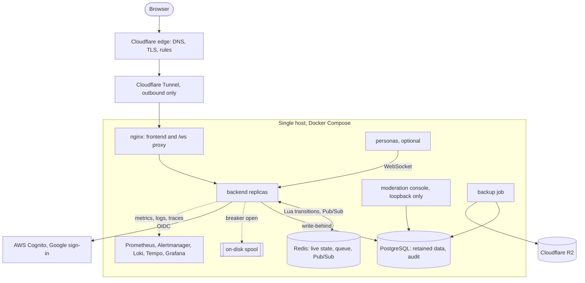
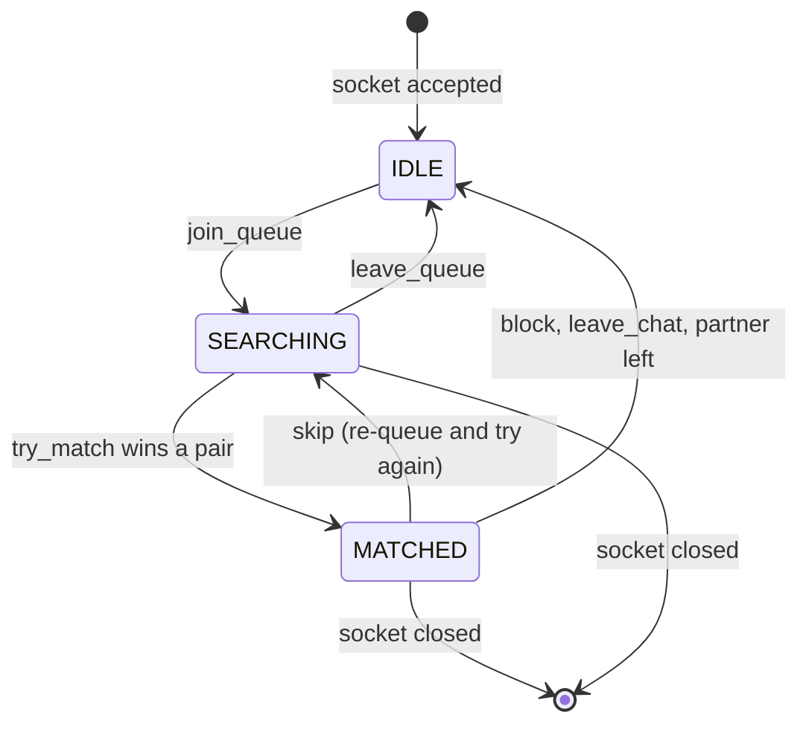

# karobakbak

Anonymous, real-time, text-only stranger chat. Two people are paired at random
over WebSockets, talk, and either one can skip, report or block at any moment.

It ran in production at [karobakbak.com](https://karobakbak.com). I designed,
built, tested, deployed and operated all of it on my own: the protocol, the
matchmaking engine, the persistence pipeline, the safety tooling, the
observability stack and the infrastructure. This README is the tour. The
[design record](./DESIGN.md) is the full contract.

## At a glance

| | |
|---|---|
| **Backend** | Node 22, TypeScript, `ws`, no HTTP framework. Redis for all live state, PostgreSQL for retained data |
| **Frontend** | React, TypeScript, Vite, Tailwind, native WebSocket, a pure reducer for UI state |
| **Correctness** | every state transition is one atomic Redis Lua script, so several backend instances can run at once with no locks and no interleaving |
| **Resilience** | write-behind persistence with priority-ordered load shedding, a circuit breaker and an on-disk spool: a database outage never becomes a chat outage |
| **Observability** | Prometheus, Alertmanager, Grafana, Loki, Tempo, Grafana Alloy, cAdvisor, Redis and PostgreSQL exporters, OpenTelemetry tracing |
| **Safety** | per-IP and per-command rate limits, a moderation rule engine over a de-obfuscated view of the text, two-dimension blocks and bans, a separate audited moderation console |
| **Infrastructure** | Docker Compose, Cloudflare (DNS, edge, Tunnel, Workers), AWS Cognito with Google sign-in, AWS Certificate Manager, Cloudflare R2 backups, GitHub Actions CI |
| **Tests** | 969 backend unit, 226 frontend unit, 686 integration tests against real Redis, PostgreSQL and sockets, a 5,000-bot load swarm and a security probe suite |

## Architecture



The host has no inbound ports: the Cloudflare Tunnel connects outward, so the
origin cannot be reached except through the edge. Redis and PostgreSQL publish
nothing. The moderation console listens on loopback and is reached through an
SSH tunnel, never through the public proxy.

More diagrams, all with sources in `docs/design/diagrams`, cover the logical
layering, network, cross-instance delivery, the conversation pipeline, and the
end-to-end flows for session creation, chat, skip, reconnect and reporting:
see [`docs/design/ARCHITECTURE.md`](./docs/design/ARCHITECTURE.md).

## Pairing and matching

The interesting problem in random chat is not sending messages. It is pairing
strangers correctly when many backend processes are making decisions at the
same time.



How it stays correct:

- **One Lua script per transition.** Join, match, skip, block and leave each run
  as a single script inside Redis, so no two instances can interleave a
  transition and there are no distributed locks to get wrong.
- **Enqueue yourself, then scan.** Two people arriving at the same instant can
  never both see an empty queue, because Redis serialises the scripts and the
  second one sees the first.
- **A set, sampled, oldest first.** The waiting queue is a Redis set. Each match
  attempt samples a few candidates and prefers the one that has waited longest,
  which keeps pairing random while bounding the worst-case wait.
- **Exactly one winner when a match ends.** Whoever deletes the match record
  wins; the other side treats "already ended" as success. No extra lock.
- **Routing that cannot go stale.** Each session has its own Pub/Sub channel, so
  the channel name is the routing key. A partner on the same instance gets a
  local fast path.
- **Preferences without a scanning tool.** Optional preference matching is
  rate limited by IP hash rather than by session, because reconnecting is free
  and a session-keyed limit would reset on the first thing an abuser tries.
- **Resumption.** A dropped socket keeps its session and its conversation for a
  short grace period, with seats reserved so a burst of reconnects cannot be
  refused for capacity.

All twenty race scenarios in the design record's concurrency analysis
(`DESIGN.md` §10) have tests against real Redis.

## Design decisions I would defend

| Decision | Why | What it costs |
|---|---|---|
| Live state only in Redis, persistence off | nothing in Redis, not even a Pub/Sub payload, can reach disk; live state is reconstructible | a Redis restart ends every session |
| Messages delivered first, persisted after | chat latency never waits on PostgreSQL | retention is lossy under overload, so it sheds in priority order and counts every drop |
| Safety records outrank ordinary chat in the write queue | reports, blocks and moderation evidence must survive a write path that cannot keep up | ordinary messages are the ones dropped first |
| Protocol types are one file duplicated byte for byte into the frontend | each package builds and ships independently | a CI check fails the build on any drift |
| No Express or Fastify | three HTTP endpoints and one upgrade path | about thirty lines of manual routing |
| Moderation console as its own process and port | a console route on the public listener would put "read retained conversations" one proxy rule away from the internet | a second process and a second database role |
| `message_ack` means accepted and routed, not read | an end-to-end receipt doubles latency | the UI says "sent", never "read" |

## Privacy by construction

- **No message content in logs, metrics, traces or errors.** A recursive field
  denylist in `backend/src/logger.ts` enforces it and throws outside production,
  so a leak fails a test instead of reaching a log file. Metric labels come from
  closed enumerations only.
- **No raw IP addresses at rest.** Only salted hashes are stored; the app refuses
  to start in production with the default salt.
- **Retention is stamped at insert time** and enforced by a leader-locked
  deletion worker, so changing a retention setting never extends the life of
  data already stored. Reports place a legal hold on what they reference in the
  same transaction.
- **Database errors are logged by code and constraint only,** because driver
  errors echo the row that failed. Core dumps and heap snapshots are disabled in
  the production image, since either would be a file full of message bodies.

## Safety and abuse controls

Described at the level of mechanism. Every threshold is configuration, and a
deployment sets its own values outside the repository.

- **Rate limits** at two layers: per IP on connections (rate and concurrency,
  counted across instances in Redis), and a separate token bucket per command
  so cheap commands cannot be used to dodge the message limit.
- **Protocol hygiene.** Text frames only, size limits before parsing, and a
  strike budget that closes connections sending malformed frames.
- **Moderation** runs rules for links, contact details, invite links and crypto
  addresses over a normalised view of the text that undoes common obfuscation
  (spacing, homoglyphs, written-out punctuation). The default action is to flag
  for human review; specific rules can be configured to block.
- **Blocks and bans** apply to two dimensions at once, a salted IP hash and a
  browser token hash. Bans are issued by a human in the console, are always
  time-bounded (there is no appeals channel, so nothing is permanent), live in
  PostgreSQL and are replayed into Redis on a timer.
- **The moderation console** is a separate process with scrypt passwords and
  TOTP, an origin allowlist, its own least-privilege database role, and an audit
  row written before any content is read. A read whose audit row cannot be
  written returns nothing.
- **Optional AI conversation partners** can fill an empty queue. They are off by
  default, need both a deployment setting and an audited console switch, have a
  monthly spend cap, and run behind a guard layer that enforces fixed limits
  between the model and the socket: no sexual content, a minor signal ends any
  romantic register for the session, no escalation under pressure, a crisis
  signal breaks character with helpline information, no soliciting personal
  details, and never claiming to be human.

## Resilience, measured

Every claim above about failure behaviour was tested by breaking things on
purpose. Highlights from [`docs/testing/RESULTS.md`](./docs/testing/RESULTS.md):

| Run | Result |
|---|---|
| 5,000 bots, 300 s, realistic traffic mix | 19,196 conversations, 79,983 messages. Message ack p50 4 ms, p95 50 ms, p99 61 ms. Time to match p99 70 ms |
| Same run, write path overloaded | 2,657 records shed, **every one ordinary chat**: zero reports, blocks or moderation evidence lost. Queue conservation held exactly |
| PostgreSQL paused mid-run | delivery steady at 43.5 msg/s, breaker opened, 10,904 records spooled and drained back, client p99 unchanged |
| One of two backends killed with SIGKILL | the survivor absorbed every session with no step in client latency |
| Redis primary stopped under Sentinel | replica promoted, about 11 s of Redis unavailability, zero backend restarts, every conversation survived with message order agreed |
| 1 vCPU, 2 GB rig shaped like a cheap VPS | about 36 KB of memory per active user; the bottleneck is CPU, with the knee between 1,000 and 2,000 concurrent users |

Fault drills found real bugs that no other test could reach, including a
rollback that waited out its deadline twice and a single orphan message that
could destroy the batch it travelled in. Both are fixed and covered by
regression tests.

The load tool is a purpose-built swarm (`load-test/swarm`), not only k6. It
drives realistic talkers, skippers, reconnecting users and deliberately abusive
personas, then checks the results with oracles against Redis, PostgreSQL,
metrics and logs. It refuses to run against anything but a local or private
address unless told explicitly.

## Observability

- **Metrics:** Prometheus scrapes every backend replica through Docker DNS, plus
  cAdvisor, Redis and PostgreSQL exporters. Grafana ships with provisioned
  dashboards, including a cost deck that turns resource use into money per
  conversation.
- **Alerts:** Alertmanager rules for things that would otherwise fail silently:
  retention deletion falling behind, safety records being dropped, the database
  breaker opening, the spool filling, backups going stale, event-loop lag.
  Alerts reach a phone through push notifications.
- **Logs:** structured JSON, collected by Grafana Alloy into Loki, with the
  content denylist applied before anything is written.
- **Traces:** OpenTelemetry across HTTP, Redis and PostgreSQL, exported to Tempo.
  Measured overhead on one core is recorded in the results log.

## From laptop to production

The deployment path, each step documented in [`docs/operations`](./docs/operations):

1. **Local:** `docker compose up` brings up the full stack with two backend
   replicas on purpose, so cross-instance behaviour is exercised every day, not
   asserted.
2. **Rehearsal rigs:** a compose overlay pins the app to one CPU core and the
   memory of a small VPS (`cpuset`, not `cpus`, so containers genuinely contend),
   and another runs Redis Sentinel for failover drills.
3. **VPS:** a cloud droplet with Caddy terminating TLS behind Cloudflare,
   provisioned from a runbook covering firewalling, users and first boot.
4. **Single host behind a Cloudflare Tunnel:** no inbound ports at all, a
   Cloudflare Worker serving a holding page when the origin is down, and
   restore drills from R2 backups. Deploys run from a workflow that refuses any
   commit CI has not passed, tags every release, and rolls back by tag.
5. **Sign-in:** AWS Cognito as the OIDC provider with Google as the identity
   provider, a custom auth domain on an AWS Certificate Manager certificate, and
   sessions in an HttpOnly cookie. Sign-in is optional; anonymous chat needs no
   account.
6. **CI:** GitHub Actions runs the full verify gate, a dependency audit and a
   secrets scan of the history on every push.

## What building this taught me

- Concurrency bugs live in the gaps between steps. Moving every transition into
  one atomic script removed whole classes of bugs instead of patching them.
- A failure you have not caused on purpose is a failure you have not tested.
  Pausing the database and killing processes mid-run found bugs that thousands
  of unit tests did not.
- Configuration that looks applied and is not is its own category of bug. Several
  settings were documented and silently ignored, so there is now a script that
  proves every setting reaches the process that reads it.
- Measure on the hardware you will pay for. The capacity estimate from a
  development machine was wrong by a factor that mattered, and the bottleneck on
  a small VPS was CPU, not memory or connections.
- Safety and privacy are easier to get right as properties of the design than as
  features added later.

## Run it

Requires Docker with the Compose plugin.

```bash
cp .env.example .env
docker compose up --build -d
open http://localhost:8081
```

Open a second private window to chat with yourself. Everything else, including
local development without Docker, the command reference, the moderation console,
metrics, alerts, production hardening and troubleshooting, is in
[`docs/operations/RUNNING.md`](./docs/operations/RUNNING.md).

```bash
npm run install:all
npm run verify              # protocol, config wiring, types, unit tests
npm run redis:test:up
npm run test:integration    # real Redis, PostgreSQL and sockets
```

## Where to read next

| | |
|---|---|
| [`DESIGN.md`](./DESIGN.md) | the contract: invariants, state machine, wire protocol, Redis data model, matchmaking, the concurrency analysis, the threat model, and what was deliberately rejected |
| [`docs/design/ARCHITECTURE.md`](./docs/design/ARCHITECTURE.md) | the architecture with diagrams of every major flow |
| [`docs/operations/RUNNING.md`](./docs/operations/RUNNING.md) | running, operating and troubleshooting the stack |
| [`docs/operations/OPERATIONS.md`](./docs/operations/OPERATIONS.md) | every operational command, from Redis to Grafana |
| [`docs/testing/RESULTS.md`](./docs/testing/RESULTS.md) | load and fault-injection results, with what each run taught |
| [`PHASES.md`](./PHASES.md) | build order and the roadmap |
| [`docs/PROGRESS.md`](./docs/PROGRESS.md) | the build log: what changed each phase, what broke and why |

## Repository layout

```
karobakbak/
├── backend/            Node + TypeScript: ws, ioredis, pg, prom-client, OpenTelemetry
│   └── src/
│       ├── protocol/   wire types and validation (source of truth)
│       ├── redis/      keys, Lua scripts, typed store
│       ├── ws/         connections, session lifecycle, janitor
│       ├── moderation/ normalisation, rules, policy
│       ├── storage/    migrations, write-behind queue, breaker, spool, deletion
│       ├── accounts/   optional sign-in, saved connections
│       ├── admin/      moderation console, enforcement, audit
│       ├── personas/   optional AI partners and their guard layer
│       ├── payments/   feature-flagged, off by default
│       └── tracing/    OpenTelemetry setup
├── frontend/           React + TypeScript + Vite + Tailwind
├── load-test/          k6 smoke test and the population swarm
├── security-test/      probes for origin checks, proxy trust, protocol abuse
├── monitoring/         Prometheus, Alertmanager, Grafana, Loki, Tempo, Alloy
├── ops/                Caddy, Cloudflare Worker, backups, restore, deploy tooling
├── scripts/            verifiers for protocol drift, config wiring, log hygiene
├── docs/               design, operations, testing, product, policies
└── docker-compose*.yml development stack plus production, VPS and Sentinel overlays
```

## License

MIT
