# System Architecture — karobakbak

**Analysis date:** 2026-09-06 · **Commit:** `5ce7166` · **Branch:** `main`

Every claim below is tagged:

| Tag | Meaning |
|---|---|
| **CONFIRMED** | Directly verified by reading the code or configuration cited beside it |
| **INFERRED** | Strongly implied by the implementation, but not stated anywhere in one place |
| **UNKNOWN** | Cannot be determined from this repository |
| **RECOMMENDATION** | Proposed. Does not exist today |

Sections 1–22 describe the system that exists. Sections 23–28 describe what
should change. They are not mixed.

### About the diagrams

**They are committed SVGs, not mermaid blocks**, and that is a decision rather
than a preference. The source stays beside each image as a `.mmd` file in
`diagrams/`, so every diagram is still editable and still reviewable in a diff.

The reason is that a mermaid block has a failure mode nothing catches. Editor
previews accept a *subset* of what the mermaid parser accepts, and when one
refuses a block it renders **nothing at all** — no error, no placeholder. That
reads as "my viewer does not support mermaid" and sends the reader down entirely
the wrong path. Three separate constructs in this file were found to trigger it,
each legal mermaid and each validated clean by the real parser:

* a `%%{init}%%` theme directive of any kind,
* `flowchart TB` where `graph TB` renders,
* `A --> B : label` with a space before the transition colon.

An image has none of that. It also carries its own background, so it reads the
same on a light editor and a dark one — which is what finally fixed the
long-running complaint that connector text was invisible. Mermaid draws
sequence-message text and edge labels straight onto the page background, so on a
dark theme roughly half of every diagram disappeared: the half carrying the
verbs.

**To change a diagram**, edit the `.mmd` beside it and re-render:

```bash
npm install @mermaid-js/mermaid-cli          # in a scratch directory
npx mmdc -i docs/design/diagrams/NAME.mmd \
         -o docs/design/diagrams/NAME.svg \
         -c theme.json -b '#FBF7EF'
```

One rule survives from the mermaid era and still applies to the `.mmd` sources:
**no `;` in a sequence-diagram message.** Mermaid reads it as a statement
separator, so `verify state; clear cookie` parses as a message plus a statement
that is not one, and the whole diagram fails to render. Use a comma or a middot.
One diagram in this file shipped broken for exactly that reason and nobody
noticed, because the other seventeen rendered.

---

## 1. Executive Summary

`karobakbak` is an anonymous, **text-only**, real-time random-stranger chat
service. Two strangers are paired at random over a WebSocket, either can skip or
block, and conversations are retained for a bounded period to support abuse
investigation and then deleted.

**Six findings that matter most:**

1. **There is no WebRTC, and no media plane of any kind.** **CONFIRMED** — a
   search of `backend/src` and `frontend/src` for `RTCPeerConnection`,
   `getUserMedia`, `createOffer`, `SDP`, `STUN`, `SFU` returns **zero** matches,
   and neither `package.json` carries a media dependency. Binary WebSocket
   frames are rejected as a deliberate architectural control
   (`backend/src/ws/connection.ts:244-272`). Your brief describes audio/video;
   the codebase does not implement it. Section 13 covers this gap honestly
   rather than documenting a signalling plane that is not there.

2. **All matchmaking state lives in Redis, and every state transition is a
   single Lua script.** **CONFIRMED** (`backend/src/redis/scripts.ts`). There is
   no read-then-write from TypeScript on any matchmaking path. This is the
   single strongest property of the system: N backend instances can mutate the
   same Redis concurrently and no transition can interleave.

3. **Cross-instance delivery uses one Redis Pub/Sub channel per session, where
   the channel name *is* the routing key.** **CONFIRMED**
   (`backend/src/ws/subscriber.ts`, `backend/src/redis/keys.ts:sessionChannel`).
   There is no routing table, so there is nothing that can go stale.

4. **PostgreSQL is never on the chat hot path.** **CONFIRMED** — retention is
   write-behind through a bounded priority queue → circuit breaker → batched
   inserts, with a disk spool when the breaker opens
   (`backend/src/storage/retention.ts`). `/ready` reflects Redis only
   (`backend/src/server.ts:612-621`), so a backend with a dead database stays in
   the load balancer and keeps serving chat.

5. **This is a modular monolith deployed as three process types, not a
   microservice system**, and that is the right shape for its scale.
   **CONFIRMED** — `backend/src/index.ts` (chat), `backend/src/admin/main.ts`
   (moderation console), `backend/src/personas/main.ts` (AI personas). The
   splits that exist are drawn on **credential boundaries**, not on domain
   boundaries.

6. **Measured capacity is CPU-bound, and the knee on 1 vCPU sits between 1,000
   and 2,000 concurrent connections.** **CONFIRMED**
   (`docs/testing/RESULTS.md:277-289`). Memory is not the constraint at any tier
   under consideration — the whole stack idles at 118 MiB.

The dominant architectural risk is **F-033: Redis is a single point of failure
for the whole service.** Sentinel support is built and drilled, but production
runs one node.

---

## 2. System Overview


**The single most important structural fact:** a persona is an *ordinary
WebSocket client*. It connects through the same edge, joins the same queue and
is matched by the same `tryMatch` script. There is no branch for it in
matchmaking. **CONFIRMED** (`backend/src/personas/client.ts`, D-AI-6).

**The Redis box above is one node because that is what is deployed, not because
that is all the code supports.** A Sentinel set — primary, replica, three
sentinels — is implemented, guarded at startup and drilled under load, and is
selected by a single environment variable. §5.1 draws both shapes and says which
one a given deployment is in.

---

## 3. Repository / Service Inventory

### 3.1 Executable applications

| # | Name | Entry point | Runtime | Responsibility | Deployment |
|---|---|---|---|---|---|
| 1 | **chat backend** | `backend/src/index.ts` | Node ≥22, CommonJS | WebSocket gateway, matchmaking orchestration, message pipeline, retention writer, deletion worker, janitor, auth routes, payment routes | `docker-compose.yml` service `backend` |
| 2 | **moderation console** | `backend/src/admin/main.ts` | Node ≥22 | Report triage, transcript review, ban issue/revoke, persona control. **Own HTTP server, own port, own DB role `karobakbak_console`** | service `admin` (not started by default) |
| 3 | **personas** | `backend/src/personas/main.ts` | Node ≥22 | AI stranger population. Holds the model API key. **Refuses to start unless `PERSONAS_ENABLED`** | service `personas` |
| 4 | **migrate** | `backend/src/storage/migrate.ts` | Node ≥22 | Deploy-time schema application, run as a different role | one-shot compose service |
| 5 | **frontend** | `frontend/src/main.tsx` → static bundle | nginx 1.x | SPA + the edge itself (geo-block, `/ws` proxy, security headers) | service `frontend` |
| 6 | **load-test swarm** | `load-test/swarm` | Node | Bot swarm + oracles. Not deployed | dev only |
| 7 | **security-test** | `security-test/run.ts` | Node | `edge`, `identity`, `protocol` probes. Not deployed | dev only |

**CONFIRMED.** There is no separate "matchmaking service", "presence service" or
"API gateway" process. Those are *modules inside process 1*.

### 3.2 Component map (module → responsibility)

| Module | Responsibility | Notes |
|---|---|---|
| `protocol/types.ts` | Wire contract, **source of truth** | Byte-identical copy at `frontend/src/protocol/types.ts`, enforced by `scripts/verify-protocol.mjs` |
| `protocol/validate.ts` | Frame validation | Must **return, never throw** (`validate-fuzz.test.ts`, ~13k frames) |
| `redis/keys.ts` | Every Redis key and channel name | Asserts every component against `[A-Za-z0-9_-]{1,128}` |
| `redis/scripts.ts` | **25 Lua scripts** — every matchmaking transition | The concurrency core |
| `redis/store.ts` | Typed wrapper over the scripts | 1,512 lines |
| `ws/upgrade.ts` | Admission bands, proxy-hop counting | `admission()` at `:41` |
| `ws/connection.ts` | Per-socket: parsing, strikes, backpressure, liveness | Never touches Redis |
| `ws/lifecycle.ts` | Session + match orchestration | Calls the store; owns the retention enqueues |
| `ws/messages.ts` | Message pipeline: limit → resolve+dedupe → moderate → deliver → ack | |
| `ws/dispatch.ts` | Local-first delivery, else publish | Returns the route taken |
| `ws/subscriber.ts` | Receiving half of cross-instance delivery | |
| `ws/janitor.ts` | Leader-locked recovery sweeps | |
| `moderation/` | Content-type dispatch → normalise → 8 rules → policy | Fails closed on unknown type |
| `storage/` | Queue, breaker, spool, repositories, deletion, migrations | |
| `accounts/` | OIDC, credentials, connections, blocks, presence, avatar relay | |
| `admin/` | Console: scrypt, TOTP, auth, review, enforce, routes, server | |
| `personas/` | Characters, surface, WS client, guard, supervisor, provider seam, budget | |
| `payments/` | Razorpay. **Off in both halves; schema is staged, not applied** | |

---

## 4. Current Architecture

### 4.1 Logical layering


**The ownership rule, stated as the code enforces it:** a layer never skips
downward. `connection.ts` never touches Redis. `lifecycle.ts` never builds a
Redis key. Lua never publishes to Pub/Sub — the janitor scripts *return
survivors* so the TypeScript caller can publish, because a script's effects are
replicated and a replica has no subscribers
(`backend/src/redis/scripts.ts:1176-1180`). **CONFIRMED.**

### 4.2 What each process must NOT do

| Process | Must not |
|---|---|
| chat backend | Hold a model API key; hold console credentials; await a PostgreSQL insert on the message path; read identity from a client frame |
| console | Delete a conversation (DB role denies it); accept an identity hash in a request body |
| personas | Get special treatment in `tryMatch`; declare `flirty`; exceed `MAX_CONNECTIONS_PER_IP` |
| Lua scripts | `PUBLISH`; contain a backtick; contain a client-supplied string in a key |

**CONFIRMED** — the DB-role split is asserted against real PostgreSQL in
`backend/tests/integration/storage.test.ts`.

---

## 5. Deployment Architecture


**CONFIRMED from `docker-compose.prod.yml`:**

- Caddy is the only service publishing host ports (`80`, `443`). Everything else
  is reachable only on the compose network.
- `backend` runs **`replicas: 1`** with a 640 MB memory limit.
- `TRUST_PROXY_HOPS` is **required**. It must equal the number of proxies in
  the deployed chain: `clientAddress()` counts N entries from the right, so a
  value below the real chain reads an entry the *client* wrote. The value is a
  property of the deployment, measured rather than assumed.
- `VITE_TERMS_URL`, `VITE_PRIVACY_URL`, `DATABASE_URL`, `IP_HASH_SALT`,
  `ALLOWED_ORIGINS` and `ACME_EMAIL` all use `${VAR:?...}` — the build **refuses**
  without them.

**Five compose profiles exist** (**CONFIRMED**): `docker-compose.yml` (dev, full
observability), `.prod.yml` (Caddy overlay), `.vps.yml` (1 vCPU, observability
scaled to 0 by the `vps:up` script, *not* by the overlay — an overlay can add a
service and cannot remove one), `.sentinel.yml` (Redis failover rig, Redis only),
`.sentinel-app.yml` (application layered onto the rig), `.test.yml` (integration
Redis).

**Scaling unit:** the chat backend is **stateless with respect to matchmaking**
and holds only a `Map<sessionId, Connection>` of local file descriptors
(`ws/registry.ts`). It is horizontally scalable *today* — the code has no
instance-affinity assumption, `no-instance-addressing.test.ts` guards that — but
production runs one replica. **CONFIRMED.**

### 5.1 Redis topology — two supported shapes, one deployed

**CONFIRMED.** The code supports a Sentinel set as a first-class production
topology, and it is drilled under load. It is **not what production runs
today**, and the distinction matters more than either half on its own.


**What decides which shape runs:** `REDIS_SENTINELS`. Empty — the default in
`docker-compose.prod.yml` and commented out in `.env.prod.example` — gives
shape A. `backend/src/redis/client.ts:61-81` branches on exactly that.

**Three guards refuse a half-specified topology at startup** rather than
degrading to one node (`config.ts:1016-1048`):

| Condition | Result |
|---|---|
| `REDIS_SENTINELS` set, `REDIS_SENTINEL_NAME` empty | **refuses to start** |
| `REDIS_SENTINEL_NAME` set, `REDIS_SENTINELS` empty | **refuses to start** |
| Both `REDIS_URL` and `REDIS_SENTINELS` set | **refuses to start** — mutually exclusive |
| Fewer than three sentinels | warns — cannot form a quorum |
| Production with no sentinels | **warns**, naming this as the one total-failure component |

That last warning is emitted on every production boot today. It is not a bug
report; it is the deployment describing itself.

**Two facts from running it, not reading it:**

- **A failover costs about 11.2 seconds and every instance leaves the load
  balancer at once**, because `/ready` derives from Redis alone. Measured with
  the swarm running: 0 backend restarts, 346 message positions agreeing across
  113 conversations (`docs/operations/OPERATIONS.md` §17.3-17.4).
- **Never give Sentinel a name that disappears with the thing it names.** The
  first rig monitored the primary by container name with
  `sentinel resolve-hostnames yes`. It formed a quorum, looked entirely correct,
  and failed over *not at all*: stopping a container removes it from Docker's
  DNS, Sentinel's lookup blocks, and the latency spike reads to Sentinel as its
  own clock jumping — so it enters TILT and deliberately stops acting. It never
  votes, and the symptom is silence rather than an error.
  `docker-compose.sentinel-app.yml` uses static addresses for this reason.

**The rig and the stack are different things.** `docker-compose.sentinel.yml` is
Redis only and drills Redis. `docker-compose.sentinel-app.yml` layers the
application on top and is what answers whether conversations survive. Both
publish the same host ports, so the load-test stack must be stopped first or the
second to start silently gets none.

**So the gap is a machine, not code** — see P1 and T1. A replica on the same
host protects against a process dying and not against the host, which is the
failure that actually takes the service down.

### 5.2 Capability state — built, deployed, receiving

The Redis-topology gap above is one instance of a general hazard here, and it is
the thing most likely to mislead a reader of this document. A subsystem in this
repository can be **fully implemented, tested, guarded and documented** while
being any of: switched off by a flag, absent from the deployment entirely, or
running and receiving nothing. All three read as "we have that" from the code,
and all three behave as "we do not" in production.

So this table is deliberately not "what exists". It is **what is running**.

| Subsystem | Built | Has a container | On in prod | What switches it |
|---|---|---|---|---|
| Chat core (WS, matchmaking, delivery) | yes | yes | **yes** | — |
| Moderation rules | yes | in backend | **yes** | `MODERATION_ENABLED` (default true) |
| Enforcement / bans | yes | in backend | **yes** | `ENFORCEMENT_ENABLED` (default true) |
| Retention writer | yes | in backend | **yes** | `RETENTION_ENABLED` (default true) |
| Outage spool | yes | in backend | **yes** | `SPOOL_ENABLED` (default true) |
| Deletion worker | yes | in backend | **yes** | `DELETION_WORKER_ENABLED` (default true) |
| Sign-in (OIDC) | yes | in backend | **yes** | `AUTH_ENABLED=true` in `.env.prod.example` |
| Avatar relay | yes | in backend | **yes** | `AUTH_AVATARS=true` |
| Metrics | yes | prometheus · grafana · alertmanager | **yes** | `METRICS_ENABLED=true` |
| Logs | yes | alloy → loki | **yes** | — |
| Backups | yes | `backup` (profile `ops`, reset in prod) | **yes** | `BACKUP_REMOTE` required in prod |
| **Redis Sentinel** | yes | drill rig + layered stack only | **no** | `REDIS_SENTINELS` — empty (§5.1) |
| **Traces** | yes | **tempo runs** | **no — it receives nothing** | `TRACING_ENABLED` (default false) |
| **Moderation console** | yes | `admin`, behind a profile | **not started by default** | `--profile admin`, plus a password for `karobakbak_console` |
| **AI personas** | yes | behind compose profile `personas` | **no** | three switches, see below |
| **Payments** | yes | in backend | **no** | `PAYMENTS_ENABLED` *and* a staged migration |
| **Premium filters** | yes | in backend | **no** | `FILTERS_ENABLED && PAYMENTS_ENABLED`, derived |

Four of those deserve their own note, because each fails in a way that does not
announce itself.

#### The moderation console now has a container — **RESOLVED**

It did not, and the gap was narrower than it first looked but real.
`OPERATIONS.md` §7e always documented `npm run console` on the host, so a
procedure existed. It would not have worked on the production box, for two
reasons neither the doc nor the alert would have revealed until somebody tried
it at 3am:

* `npm run console` runs through **`tsx`, a devDependency**, and nothing
  installs `backend/node_modules` on the box — the application arrives as an
  image with its dependencies inside it. `GOING-LIVE.md` installs Node only so
  `security:probe` and `verify:logs` can run.
* The `console` script passes **no `--env-file`**, unlike `dev`. It would have
  started with an empty environment, hit `ADMIN_CONSOLE_ENABLED` defaulting to
  false, and refused.

The fix needed no new image. `tsconfig.build` compiles all of `src`, so
`dist/admin/main.js` and the console's static files were **already inside the
backend image** — the Dockerfile copies `src/admin/public` in explicitly. The
`admin` service reuses that image with a different command, behind a profile,
published on host loopback, connecting as `karobakbak_console`.

**Installing the dev tree on the box was the wrong fix**, and worth recording as
such: it would run every package's install scripts on the machine holding the
database, the hash salt and the spool, and it would falsify the reasoning behind
the CI audit gate — which omits dev dependencies precisely because they never
reach production.

The `karobakbak_console` role ships `nologin`, like `karobakbak_app`, and is
given a password out of band. Running the service once on the real host is what
turns this from a claim into a fact: the F-049 lesson, the broken backup that
every local drill passed.

#### Tempo is deployed and receives nothing — **CONFIRMED**

`TRACING_ENABLED` defaults to **false** (`config.ts:1631`), `docker-compose.yml`
passes `${TRACING_ENABLED:-false}`, and neither `.env.prod.example` nor the prod
overlay sets it. `.env.vps.example` sets it to `false` explicitly. The `tempo` container
runs regardless — the compose file's own comment says the container "is usually"
idle for exactly this reason.

This is the precise shape of **F-041**, which is already recorded: tracing that
exports nothing "reports no error — Tempo simply stays empty, which looks like a
quiet system." The finding was about start-up order; the same symptom is now
reachable through configuration, and an empty trace store is indistinguishable
from a healthy idle one.

#### Personas need three yeses, not one — **CONFIRMED**

1. `PERSONAS_ENABLED` must be true — it defaults false and the process
   **refuses to start** otherwise rather than idling.
2. The compose profile `personas` must be selected; `prod:up` does not.
3. A row in `persona_control` must permit it, and **it ships disabled**.

The third is the durable one, and that is deliberate: "the deployment setting is
the operator's; the durable switch is the one somebody reaches for at 2am when
the bill or the behaviour is wrong, and it must not be undone by a redeploy."

#### Payments are off in both halves, and the schema is staged — **CONFIRMED**

`PAYMENTS_ENABLED` is false in the backend *and* `frontend/src/features.ts:102`
compiles `PAYMENTS_ENABLED = false` into the bundle. Separately,
`011_payments.sql` sits in `migrations-pending/`, not `migrations/`. Turning the
flag on without applying it leaves the routes existing while every order fails —
which reads as a broken integration rather than a missing table.

`FILTERS_AVAILABLE` is derived (`FILTERS_ENABLED && PAYMENTS_ENABLED`) rather
than settable, because each half refuses for its own reason and a single flag
would let one of them be forgotten.

**Not present:** Kubernetes, service mesh, service discovery, autoscaling,
multi-region, multi-AZ. **CONFIRMED** by absence from every compose file and the
`ops/` directory.

---

## 6. Network Architecture

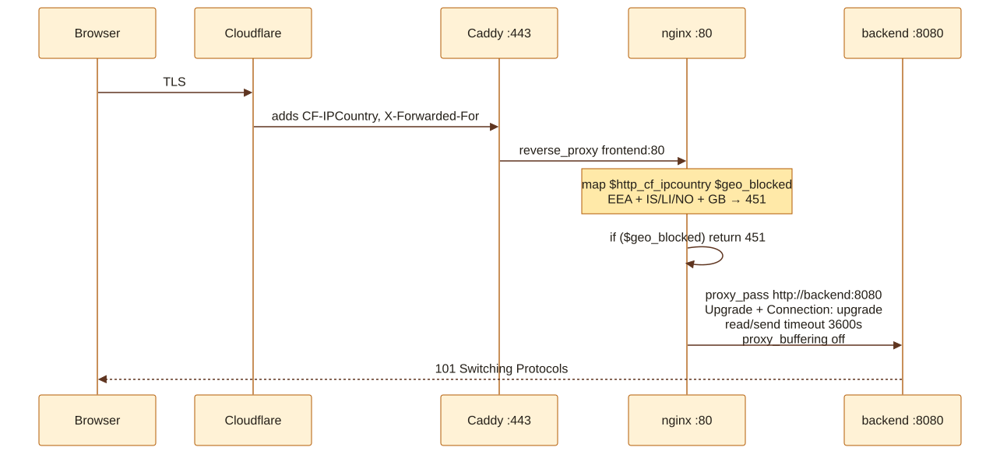

**CONFIRMED from `frontend/nginx.conf`:**

| Route | Behaviour |
|---|---|
| `/` | SPA, `try_files … /index.html`, geo-checked |
| `/assets/` | `expires 1y`, `immutable` |
| `= /index.html` | `no-store` |
| `\.map$` | `404` — source maps not served |
| `/ws` | Proxied to backend, **geo-checked** |
| `/auth/` | Proxied, geo-checked |
| `= /api/capacity` | Proxied, geo-checked |
| `= /api/payments/create-order` | Proxied, geo-checked |
| `= /api/webhooks/razorpay` | Proxied, **not** geo-checked (a provider callback is not a user) |

Two non-obvious facts recorded in the config and confirmed by reading it:

1. The geo-check is repeated **inside each location** rather than once in the
   server block, because `error_page` does not intercept a `return` from an `if`
   in the server block — the status arrives with an empty body.
2. `/ws` **must** be covered. Refusing the page while leaving the socket open
   restricts nothing: anybody holding the bundle connects straight past it.

**Access log format** is a custom `kbb_access` JSON format using `$uri`, **not**
`$request` — the stock `main` format logged the OIDC authorization code out of
the query string on every completed sign-in (F-036). `remote_addr` and
`forwarded_for` are logged deliberately; the privacy policy §8 agrees.
**CONFIRMED.**

---

## 7. Service Responsibilities

| Concern | Owner | Source of truth |
|---|---|---|
| Which socket belongs to which session | backend instance, in memory | `ws/registry.ts` — **local lookup only, never routing** |
| Session state (`IDLE`/`SEARCHING`/`MATCHED`) | **Redis** | `chat:session:{sid}` hash |
| Queue membership | **Redis** | `chat:queue:{segment}` SET |
| Match existence | **Redis** | `chat:match:{mid}` hash + `chat:user_match:{sid}` |
| Who a session is talking to | **Redis** | `resolveRouteInline` in the Lua prelude |
| Message content, durably | **PostgreSQL**, eventually | `messages.body` |
| Whether a person is banned | **PostgreSQL**; Redis is a cache | `enforcement` table; `reapplyActiveBans` replays on restart |
| Whether a person paid | **PostgreSQL** `accounts.premium_until`; the *gate* is the Redis session field `premiumUntil` | D51 |
| Presence count shown in the UI | Redis cardinalities | Hidden below 100 online, never faked (D21) |

**CONFIRMED.** The pattern "PostgreSQL is truth, Redis is a cache, and startup
replays" appears three times — bans (D31), persona spend, persona kill switch —
because **Redis runs with persistence off (D12)**, so anything stored only there
returns to its compiled-in default on restart.

---

## 8. Data Architecture

### 8.1 Redis — ephemeral and authoritative

**CONFIRMED** from `backend/src/redis/keys.ts` (every key in the system is
declared in this one file; nothing concatenates a key at a call site).

| Key | Type | Contents | TTL |
|---|---|---|---|
| `chat:session:{sid}` | HASH | `sid, state, instanceId, segment, ipHash, clientHash, createdAt, lastSeenAt, matchId, enqueuedAt, resumeHash, detachedAt, nickname, pGender, pCountry, intent, prefG, prefC, account, premiumUntil` | `SESSION_TTL_SECONDS` = **120s**, refreshed by heartbeat |
| `chat:sessions` | SET | every known session id, for the janitor | — |
| `chat:queue:{segment}` | SET | session ids currently SEARCHING | — |
| `chat:segments` | SET | segment names ever used | — |
| `chat:match:{mid}` | HASH | `a, b, segment, createdAt, identA, identB, save:{sid}` | `MATCH_TTL_SECONDS` = **3600s** |
| `chat:matches` | SET | live match ids | — |
| `chat:user_match:{sid}` | STRING | the match id — **the hot-path authorisation read (D5)** | match TTL |
| `chat:dedupe:{mid}` | SET | client message ids already accepted (I14) | match TTL, capped at `DEDUPE_MAX_ENTRIES` = 10,000 |
| `chat:last_partner:{sid}` | HASH | departed partner's two hashes, for a late block (D38) | `BLOCK_LATE_WINDOW_SECONDS` = **120s** |
| `chat:blocks:{blockKey}` | SET | peers this key refuses (D18) | `BLOCK_TTL_SECONDS` = **30 days** |
| `chat:ban:{subjectKey}` | STRING | absolute ban, read **before a session exists** | remaining life recomputed from `expires_at` |
| `chat:resume:{tokenHash}` | STRING | resume-token hash → session id | session TTL |
| `chat:rl:{command}:{sid}` | HASH | token bucket `t`, `ts` | per-limit |
| `chat:rl:conn:{ipHash}` | STRING | connection attempts in window | `CONN_RATE_WINDOW_SECONDS` |
| `chat:conn:{ipHash}` | SET | sessions from one IP (R8) | — |
| `chat:pref:cd:{ipHash}` / `chat:rl:pref:{ipHash}` | STRING / HASH | preference cooldown + hourly budget | §29.4 |
| `chat:premium:{accountId}` | STRING | cached deadline, empty string = cached negative | `AVATAR/premium cache` |
| `chat:online:{accountId}` | STRING | **visibility** — may others see them | short |
| `chat:sess:{accountId}` | STRING | **routing** — where to deliver | heartbeat |
| `chat:active:{accountId}` | STRING | the hour `accounts.last_active_at` was last written (D65); a write gate, not a record | 2h |
| `chat:ptok:{token}` | STRING | presence token → account | 12h signed in, session-lifetime signed out |
| `chat:instance:{iid}` / `chat:instances` | STRING / SET | liveness beacons | `INSTANCE_HEARTBEAT_TTL_SECONDS` |
| `chat:janitor:lock`, `chat:deletion:lock` | STRING | leader locks, **separate so they never contend** | lock TTL |
| `chat:ev:session:{sid}` | Pub/Sub channel | the routing key itself | n/a |

**Two design decisions worth naming.** `chat:online:` and `chat:sess:` are
separate keys because conflating them meant somebody who hid their presence
could not be *routed to at all, including by themselves*. And `chat:blocks:` and
`chat:ban:` are separate namespaces because a moderator revoking a ban would
otherwise silently delete a user's own block. **CONFIRMED** —
`backend/tests/integration/blocks.test.ts` tests the second case explicitly (D29).

### 8.2 PostgreSQL — durable

**CONFIRMED** from `backend/src/storage/migrations/` (16 applied, 1 staged).


**Retention and deletion.**

- `retention_expires_at` is **stamped at insert time, never computed at
  deletion time** (D17). A config change must not retroactively extend the life
  of already-stored user data. The column has **no default** — deliberately, so
  the value is provably the application's.
  **CONFIRMED**: `backend/tests/integration/retention-integrity.test.ts` builds
  a second `Repositories` over the same database with a longer window and
  asserts old rows keep their stamp.
- Default `CONVERSATION_RETENTION_DAYS` = **30**.
- Deletion is a **leader-locked worker** (`storage/deletion.ts`), guarded in
  **both directions** by `legal_hold`: a parent under hold is excluded, and a
  child under hold prevents the parent being emptied. "An empty shell with a
  timestamp is not a suspended conversation."

**Two schema invariants defended by tests rather than by review:**

- `connections` **must never gain a `conversation_id`** — that is the column the
  natural description of the feature ("we met in conversation X") invites, and
  it would tie a durable relationship to a specific chat. A test asserts the
  column list against the live schema.
- `accounts.external_id` is **never the primary key**. Payments reference
  `accounts.id`; handing that key to an identity vendor defines a financial
  record on a system this project does not control.

**Backup:** `ops/backup/` — dump, encrypt, copy off-host, prune. `BACKUP_REMOTE`
is required in production; a backup living on the machine it protects is worse
than the absence it replaces. The backend exposes `POST
/internal/backup-observed` (bearer, constant-time compare, unreachable from the
edge) so `BackupMonitor` can report rather than the chat process reaching into
the backup system. **CONFIRMED** (`backend/src/server.ts:415-465`).

---

## 9. State Management

| Category | Source of truth | Lifetime | Survives? |
|---|---|---|---|
| **Client UI state** | `frontend/src/state/machine.ts` — a **mirror**, never a decider | Tab | No |
| **Recent** (who you met this visit) | `sessionStorage` — **never a server** | Tab | No |
| **Resume token** | `sessionStorage`; SHA-256 only in Redis | Tab | No |
| **Connection state** (socket) | backend `Map` | Socket | No |
| **Session** | Redis hash | 120s TTL, heartbeat-refreshed, +20s detached grace | Redis restart loses it |
| **Queue membership** | Redis SET | Until matched/left/reaped | No |
| **Match** | Redis hash | 3600s TTL | No |
| **Declared profile** | Redis session hash — **rides `join_queue`, dies with the session** | Session | No |
| **Matching preference** | Redis session hash (`prefG`/`prefC`) | Session | No |
| **Nickname** | Redis session hash, drawn once at `createSession` | **Session, not match** (D50) | No |
| **Blocks** | Redis SET **and** a PostgreSQL row | 30 days | Yes (PG) |
| **Bans** | PostgreSQL; Redis cache | `expires_at` | Yes, replayed at boot |
| **Account** | PostgreSQL | Retention window | Yes |
| **Conversations/messages** | PostgreSQL, write-behind | 30 days | Yes |

**The load-bearing negative:** the server keeps **no profile between sessions**.
It rides on `join_queue`, lives on the session hash, dies with the session, and
the browser re-sends it (D34). Storing it against the block token or IP hash
would be the cross-chat correlator §24.3 forbids. A join carries the **whole**
profile — a missing field is deleted, because there is no partial update.
**CONFIRMED** (`backend/src/ws/lifecycle.ts:425-450`).

---

## 10. Authentication & Session Architecture

There are **three unrelated identity concepts**, and keeping them apart is
deliberate.

### 10.1 The anonymous chat session — no authentication at all

**CONFIRMED.** A WebSocket upgrade creates a session with no credential
whatsoever. `sessionId` is sent to the client "for log correlation only. It
grants no capability" (`protocol/types.ts:ConnectedPayload`). **No inbound frame
is ever authorised by a client-supplied id** — protocol rule 3. The server
resolves the partner, the reported party, the block target and the country
itself.

Identity for *abuse control* is two salted hashes computed at the upgrade:

```
ipHash     = sha256(salt + clientAddress(req, TRUST_PROXY_HOPS))
clientHash = sha256(salt + clientToken)      // token in a cookie, issued if absent
```

**CONFIRMED** (`backend/src/server.ts:724-729`, `ws/identity.ts`).

### 10.2 The resume token — a bearer credential for one session

**CONFIRMED** (`§28`, `backend/src/ws/lifecycle.ts:354-386`,
`redis/scripts.ts:resumeSession`).

- Presented as a **WebSocket subprotocol** (`kbb.resume.<token>`), because
  `WebSocket` takes no custom headers and unlike a query string a subprotocol
  does not land in an access log.
- Stored **only as SHA-256**.
- **Rotated on every redemption** — captured token is good for one use.
- **Refused for a session that is still attached** — the script checks
  `detachedAt` and returns `NOT_DETACHED`. Without that, a second tab or a
  captured token could take over a live conversation while the holder watched.
- The server **never echoes it** in `Sec-WebSocket-Protocol`
  (`handleProtocols` selects only `kbb.v1`).
- A failed resume opens a **fresh session**, never an error.

### 10.3 The account — OIDC, free, optional

**CONFIRMED** (`backend/src/accounts/oidc.ts`, `routes.ts`).

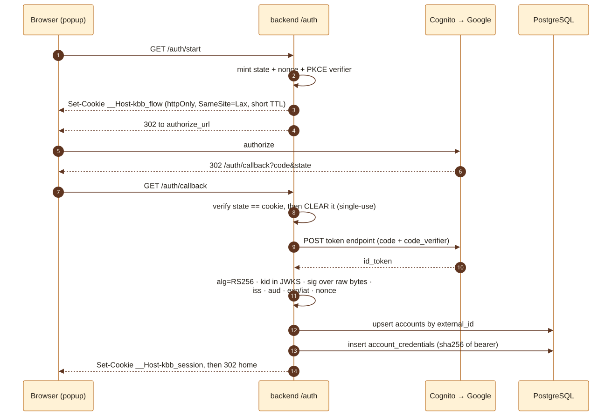

Deliberate choices, each with a stated failure mode:

- **No JWT library.** Node verifies a JWK natively. Acceptable *only* because
  every failing case is tested: `alg: none`, `HS256` (the key would be the
  public key), another pool's `iss`, another client's `aud`, expiry, replayed
  `nonce`, unknown `kid`. **Never add a check without a test for it failing.**
- **`SameSite=Lax`, not `Strict`.** Strict is dropped on the provider's
  cross-site redirect back, which breaks sign-in *only for the people who
  completed it* — the worst possible distribution of a bug.
- **`__Host-` prefix dropped on local HTTP** rather than left to fail silently.
- Session TTL default **30 days** (`AUTH_SESSION_TTL_SECONDS` = 2,592,000).

**A session's `accountId` is read from the cookie at the WebSocket handshake and
nowhere else** (`backend/src/server.ts:686-690`). Sign-in happens in a popup
that deliberately does not reload the page, so an open socket keeps the identity
it opened with. The client closes and re-opens; the resume token re-attaches the
same session. **Both halves are required** — without the first the cookie is
never seen, without the second the session row stays empty until the next search.

### 10.4 Console operators — a fourth, fully separate system

scrypt + TOTP, own port, own DB role, own process, `ADMIN_SESSION_TTL_SECONDS`
= 12h. `admin_accounts` is denied to `karobakbak_app` outright. **CONFIRMED.**

---

## 11. Matchmaking Architecture

This is the heart of the system and the part most carefully built.

### 11.1 The shape

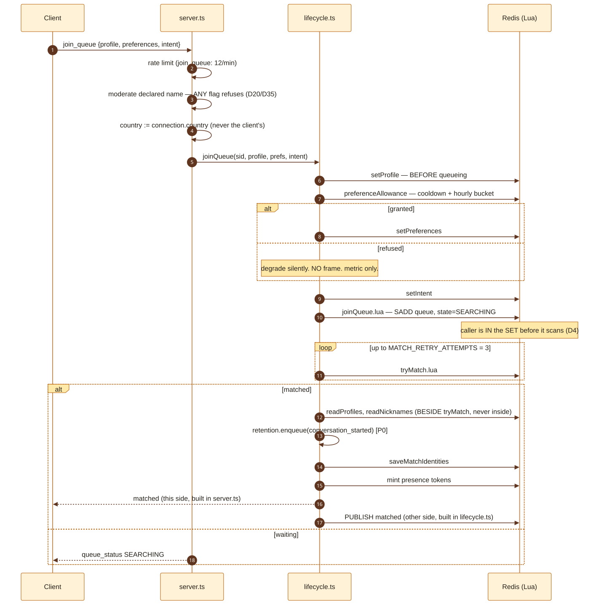

### 11.2 `tryMatch` — what actually prevents double-matching

**CONFIRMED** (`backend/src/redis/scripts.ts:444-668`).

The question "what prevents two workers from matching the same user
simultaneously?" has a precise answer here:

1. **Redis executes one script at a time to completion.** The entire selection
   and the entire commit are inside one `EVALSHA`. There is no window.
2. The caller is `SADD`ed to the queue **before** it scans (D4), so two
   simultaneous joiners cannot both see an empty queue.
3. The script re-reads its own preconditions inside itself:
   `EXISTS session` → `GET user_match` → `HMGET state` must be `SEARCHING`.
   Any failure `SREM`s the caller and returns `ABORT` — so an abort never leaves
   a stale entry.
4. Selection and commit are inseparable: the winning script does
   `SREM queue sid, chosen` / `SET user_match` ×2 / `HSET match` / `SADD matches`
   / `HSET state=MATCHED` ×2 in the same invocation.
5. A candidate that was matched by a different instance between the `SRANDMEMBER`
   and the `HMGET` fails `GET kUserMatch(c)` and is `SREM`ed as stale.

**Verdict: double-matching is structurally impossible, not merely unlikely.**
The residual is a *loser* whose own attempt returns `ABORT / ALREADY_MATCHED`,
which is handled by sending nothing — the `matched` frame is already inbound
from the winner (`lifecycle.ts:770-773`).

### 11.3 Fairness and the preference score

- **Sampling:** `SRANDMEMBER queue (sample+1)` where `MATCH_CANDIDATE_SAMPLE` =
  **8**. Random sampling, then **longest-waiting wins** (`enqueuedAt` from the
  Redis `TIME` clock, never a host clock — fairness compares values written by
  different instances).
- **Scoring (D44):** gender **4**, country **2**, intent **1**. Highest wins;
  longest-waiting breaks a tie; **zero is the ordinary candidate**, which is why
  the fallback needs no special case. A preference can never make somebody wait.
- Gender **outweighs the other two combined**, on purpose — there is a test named
  after that, because the weights are a decision, not a constant to tune.
- **Escalation:** one wider pass (`PREFERENCE_WIDE_SAMPLE` = 32) *only* when the
  ordinary sample scored zero and a paid preference was declared. A `seen` table
  prevents the overlapping samples double-counting the diagnostics.
- **Intent is deliberately excluded from `anyPreference`** — most of the
  population will declare one, and counting it would put the expensive second
  pass on nearly every search to chase a dimension worth 1.
- **Queue GC is a side effect of scanning** (§10.11): every scan `SREM`s the
  stale entries it walks over, so a crashed instance's entries do not accumulate.

### 11.4 Blocks inside matching

`isBlocked` checks **both dimensions in both directions** (I12). A blocked
candidate is **skipped, never removed** — it is blocked relative to *this*
searcher only and must stay matchable for everyone else. **CONFIRMED.**

### 11.5 Reconnect — no new script

Reconnecting two people who met before writes a random `pair-…` segment on both
sessions and lets ordinary `tryMatch` do the rest
(`backend/src/index.ts:reconnect.pair`). That is why blocks, bans and rate limits
all still apply with no reconnect-specific code. The lane is **random, not
derived from the two session ids** — a derived lane would be a stable identifier
for a pair sitting in a key name. **CONFIRMED.**

---

## 12. Real-Time Communication Architecture

### 12.1 Transport

**CONFIRMED.** Single WebSocket per browser tab, path `/ws`, subprotocol
`kbb.v1`. JSON envelopes. `maxPayload = MAX_FRAME_BYTES` (16 KB) enforced by
`ws` **before** this process allocates the payload. Binary frames are rejected.

**Client → server (11 commands):** `join_queue`, `leave_queue`, `leave_chat`,
`message`, `typing`, `react`, `save_connection`, `skip`, `report`, `block`,
`ping`.

**Server → client (21 events):** `connected`, `queue_status`, `presence`,
`matched`, `message`, `message_ack`, `partner_typing`, `partner_reacted`,
`connection_state`, `connection_request`, `reconnect_request`, `reconnect_ready`,
`connection_made`, `partner_skipped`, `partner_reconnecting`, `partner_returned`,
`partner_disconnected`, `report_ack`, `error`, `pong`, `server_shutdown`.

### 12.2 Cross-instance delivery


**Dropping is a designed outcome, not a bug.** **CONFIRMED**
(`backend/src/ws/dispatch.ts:8-20`). Every event reports state *already
committed in Redis*, so a lost notification costs at most one stale UI label and
the client's next action re-reads authoritative state. Redis Streams were
explicitly rejected: durability at the price of trimming policy, consumer-group
lifecycle and per-session cursors, for notifications about ephemeral state.

**Subscribe happens before the session row exists** (`server.ts:812-816`,
`lifecycle.open` `beforeCreate` callback). Getting that order wrong loses the
`matched` event of exactly the users who were quickest.

### 12.3 Message pipeline ordering — the contract

```
rate limit → resolvePartner + dedupe (ONE script) → moderate → deliver → ack → persist
```

**CONFIRMED** (`backend/src/ws/messages.ts:1-31, 128-246`).

- Limit first, because a limit applied after the work is not a limit.
- Route resolution and dedupe are **one Lua script** — as two round trips, two
  concurrent copies of the same frame could both pass (§10.17, I14).
- The dedupe entry is written **last inside the script**, after the partner
  resolves, so a message that could not be routed does not burn its id.
- **`message_ack` means "accepted and routed", never "received"** (D14). It
  carries `route` (where the partner's socket is) and `status`
  (`routed`/`withheld`/`undelivered`).
- Persist is **after** the ack decision and cannot fail the send.

### 12.4 Ordering, delivery, duplicates

| Property | Behaviour |
|---|---|
| **Ordering** | Per-sender FIFO by TCP + single-threaded handling. **No global ordering across the pair.** **INFERRED** — nothing sequences the two directions |
| **At-most-once** | Yes. No retry, no buffer, no store-and-forward |
| **Duplicate suppression** | `chat:dedupe:{mid}` SET on `clientMsgId`, capped at 10,000; over the cap the message is **refused**, not delivered undeduplicated |
| **Timestamps** | `serverTimestamp` only. A client timestamp is never read |
| **Partner away** | Messages are **not buffered** (D43) — buffering would write message text to a Redis key, which I8 forbids. The composer is disabled instead |

---

## 13. WebRTC Architecture

### **CONFIRMED: WebRTC is not implemented. There is no signalling plane and no media plane.**

Evidence:

| Check | Result |
|---|---|
| `grep -riE 'RTCPeerConnection\|getUserMedia\|createOffer\|createAnswer\|iceCandidate\|\bSDP\b\|\bSTUN\b\|\bSFU\b'` over `backend/src` + `frontend/src` | **0 matches** |
| WebRTC/media dependency in either `package.json` | none |
| STUN/TURN service in any compose file | none |
| `call.*` or media protocol events | none |
| Binary WebSocket frames | **rejected** — `ws/connection.ts` treats `isBinary` as a protocol strike |
| `MessageContentType` | `['text']` — a closed list of one |
| `messages.type` column | `check (type in ('text'))` |

`DESIGN.md` §23 records media as **deliberately rejected**, and `CLAUDE.md`
states the prohibition operationally: no object storage, no CDN, no STUN, no
TURN, no SFU, no media servers, no `media_id` column. The `type` discriminator
exists only so a future content type would not force a protocol version bump —
"it is not permission to build media."

**Consequence for this document:** there is no signalling plane to separate from
a media plane, no ICE state machine to draw, and no TURN bandwidth to model.
Section 24 treats WebRTC as a **target-state addition** and says what it would
cost. Anything else would be inventing architecture.

---

## 14. Conversation Architecture


**CONFIRMED.** Four properties worth stating:

1. **A conversation ends exactly once.** `endMatchInline` does
   `DEL kMatch(mid)`; **only the caller whose `DEL` returns 1** is the winner
   (D6). Everyone else gets `ALREADY_ENDED` and stays silent — otherwise the
   peer would be told twice.
2. **The retention rows are ordered against the foreign key.**
   `conversation_started` (P0) is enqueued *before* `saveMatchIdentities`,
   deliberately, so the parent row exists for the `conversation_ended` that
   whoever ends it will enqueue.
3. **`message_count`, `ended_at` and `end_reason`** are filled by the write-behind
   path. A match reaped by the janitor used to leave them null forever; the
   janitor now returns the ended ids so the caller writes the row.
4. **Access control on a retained conversation:** the console must have a
   **report** to open one — except persona conversations, which are browsable
   without one (D-AI-12), which is exactly why the audit trail and the one-year
   audit retention are non-negotiable there.

---

## 15. Moderation & Abuse Prevention

### 15.1 Synchronous, in-process, deterministic

**CONFIRMED** (`backend/src/moderation/`). There is **no external moderation
provider**, no ML model, no async review queue on the message path.

```
moderate(content, policy)
  → switch on content.type      // dispatch, NOT moderateText(text)  §23.5
  → 'text': moderationView(text)   // normalisation: confusables, spacing
  → evaluateText → 8 regex rules
  → default:  UNSUPPORTED = { action: 'block' }   // FAILS CLOSED
```

**Rules** (`moderation/rules.ts:107-166`): `url` (medium), `email` (high),
`phone` (high), `social_handle` (medium), `invite_link` (high),
`crypto_address` (high), `contact_solicitation` (low), `deny_list` (high).

**Actions:** `allow` | `flag` | `withhold` | `block`. Default for a match is
**`flag`** — delivered, and a `moderation_events` row written per rule that
fired. A rule in `MODERATION_HARD_BLOCK_RULES` produces `block`: refused, and —
crucially — **still persisted**, because a hard block is the highest-confidence
evidence in the system and returning early made the most serious abuse the only
kind that left nothing behind.

**A declared name is refused on *any* flag** (D35), unlike a message (D20). A
message is one utterance judged in context; a name is a label shown to everyone
that session meets.

### 15.2 Reports

`report` → server resolves the reported party from `resolveRoute` (a client
never names who it is reporting) → enqueue at **P0** → **if the queue refuses,
the report is NOT acknowledged** and the client gets `INTERNAL_ERROR` with a
retry hint. Telling a user asking for help that their report was filed when it
was not is the one lie the system refuses to tell (§14.3). **CONFIRMED**
(`backend/src/server.ts:1338-1382`).

A partner whose session already expired is **still reportable** — the
conversation and its messages are what the report references.

### 15.3 Blocks vs bans

| | Block | Ban |
|---|---|---|
| Meaning | Relative — a set of peers *one user* refuses | Absolute — no session at all |
| Storage | `chat:blocks:{key}` SET + `blocks` row | `chat:ban:{key}` STRING + `enforcement` row |
| Checked | Inside `tryMatch` | At the **upgrade, before a session exists** (I11) |
| Keyed on | ipHash **and** clientHash, both directions | subject key |
| Issued by | The user | A moderator, via the console, resolved server-side |
| Survives restart | Yes (PG) | Yes — `reapplyActiveBans` replays with **recomputed** remaining life |

A ban check failure at the upgrade **refuses** the connection rather than
admitting it. Fail-open is the usual instinct and is wrong here: `/ready` has
already dropped the instance from the load balancer, so the connection was going
to fail anyway — whereas failing open silently un-bans every sanctioned user for
the duration of the outage. **CONFIRMED** (`backend/src/server.ts:740-756`).

### 15.4 What is deliberately *not* disclosed

- A blocked partner is told `partner_skipped`, identical to an ordinary skip.
- A `leave_chat` is also `partner_skipped` — "they left rather than skipped" is a
  behavioural detail about another user that nothing needs.
- **No metric counts a refusal.** A one-sided saved connection, an ignored
  reconnect request, a request stopped by a block: each is a private decision,
  and an aggregate turns it into an operational statistic.

### 15.5 Accepted limits (from `docs/testing/FINDINGS.md:49-64`)

- **Blocking does not bound a spammer.** A block protects the blocker and
  nobody else; bounding a sender across many strangers is a moderation and
  sanction question, not a block.
- **A block racing a teardown** is partly mitigated by the 120s late-block
  window (D38) and still loses some.
- There is **no proactive detector** — that is a purpose-scope decision with its
  own false-positive budget, not an oversight.

---

## 16. Security Architecture

### 16.1 What exists — **CONFIRMED**

| Control | Where | Detail |
|---|---|---|
| Origin allowlist on upgrade | `server.ts:695-704` | Refused without saying what would be accepted |
| Ban check pre-session | `server.ts:740-771` | Fails **closed** |
| Connection rate limit per IP | `lifecycle.open` → `connRateLimit` Lua | `CONN_RATE_LIMIT` per `CONN_RATE_WINDOW_SECONDS` (shipped default 30 per 60s; a deployment sets its own) |
| Concurrent connections per IP | `connAcquire` Lua, `chat:conn:{ipHash}` | `MAX_CONNECTIONS_PER_IP` (shipped default 20) |
| Admission bands | `ws/upgrade.ts:41` | open / reserved / full; reserve is for **resumptions only** (D63) |
| Per-command token buckets | `store.rateLimit`, one bucket per command | Shipped defaults: message 3/s burst 8 · join 10/min · skip 15/min · report **6/h** burst 2 · block **12/h**. Source of truth is `backend/src/config.ts` |
| Frame size | `ws` `maxPayload` = 16 KB | Enforced before allocation |
| Protocol strikes | `connection.ts:316-330` | `INVALID_MESSAGE_STRIKES` → close 4003 |
| Backpressure | `connection.ts:175-181` | `bufferedAmount > MAX_BUFFERED_BYTES` → close 1013 |
| Binary rejection | `connection.ts` | Architectural, not a nicety |
| Fuzz-tested validator | `validate-fuzz.test.ts` | ~13k seeded frames; **must return, never throw** |
| Key-component assertion | `redis/keys.ts:assertComponent` | No client string can ever become a Redis key |
| Salted IP hashing | `IP_HASH_SALT` required in prod | Raw address never logged by the app |
| Constant-time secret compare | `server.ts:646-651` | Hash both sides first, so lengths do not leak |
| CSP / security headers | `frontend/security-headers.conf` | `img-src 'self' data:` + payment provider only |
| No third-party embeds | policy + code | The Buy-Me-a-Coffee SVG is fetched once and self-served |
| Log denylist | `logger.ts` | Recursive field denylist that **throws outside production** |
| Span attribute denylist | `tracing/scrub.ts` | Separate control (D52/D53) — `enhancedDatabaseReporting:false` does **not** stop `db.query.text` |
| Log-hygiene detector | `scripts/verify-log-hygiene.mjs` | Reads back what reached Loki; reports a truncated SHA-256, never the value |
| DB role separation | `002_roles.sql` | `karobakbak_app` denied `admin_accounts`; `karobakbak_console` cannot delete a conversation |
| Console XSS guard | test | `console.js` must never gain an `innerHTML` |
| Console cannot name a ban subject | `issueBanForReport` | Resolved server-side from the report (§25.3) |
| Audit before read | D33 | The audit row is written **before** the content is selected, **in the same transaction** |
| Webhook signature | `payments/signature.ts` | Returns a **verdict** (`valid`/`invalid`/`malformed`/`unconfigured`), not a boolean |
| CI security | `.github/workflows/verify.yml` | `npm audit --omit=dev` gated at `high`; secret-history scan; lockfile agreement; CRLF check |
| Live probes | `security-test/` | `edge`, `identity`, `protocol`; `TRUST_PROXY_HOPS` reported as **INFO**, never a verdict |

### 16.2 The single most important application rule

**Message content is plaintext inside a trusted boundary and must never leave
it.** The boundary is: Node process memory, the bounded persistence queue, the
outage spool, `messages.body`, and a Pub/Sub payload in flight. Outside that:
never a log line, an error message, a Prometheus **label *or value***, a Grafana
annotation, a tracing span, an analytics event, or a crash report.
`reports.note` carries the same rule.

**CONFIRMED** and enforced by four independent mechanisms: the logger denylist
(throws outside production), the span scrubber, the metric-label rule
(`conversation_id` is never a label — unbounded cardinality *and* half a content
leak), and the log-hygiene detector reading back from Loki.

Two consequences a reader will otherwise trip over:

- **Never log a `pg` error object** — the driver echoes parameter values (the row
  you tried to insert) on constraint violations. Use `dbErrorFields()`.
- **Never build an `Error` by interpolating message content** — `errMsg` is a
  legitimate field, so an interpolated body survives the denylist.

### 16.3 What is missing — **CONFIRMED absent**

| Gap | Assessment |
|---|---|
| **No application-level encryption of message bodies** | Deliberate (D15). Retained content is protected by infrastructure controls only. This is stated in the privacy policy; it is a decision, not a defect — but it is the reason the logger denylist is the *primary* control |
| **No WAF rules in the repo** | Cloudflare is inferred from `CF-IPCountry` but no WAF configuration is version-controlled |
| **No secret manager** | Known limitation: secrets arrive as env vars via `env_file`, delivered whole, so the app container's environment also holds credentials it never reads (the database superuser and Grafana admin passwords). Stated in `.env.prod.example` |
| **No mTLS between services** | All internal traffic is plaintext on the compose bridge network |
| **`DATABASE_SSL: false` in prod compose** | Acceptable only because Postgres is on the same host. Becomes a real gap the moment the database moves |
| **No CSRF token on `/auth/*` POSTs** | Known limitation. Relies on `SameSite=Lax`, a `__Host-` cookie and a JSON content type; adequacy not independently verified |
| **No account-level rate limiting** | Limits key on session id or IP hash. An account is not a bucket anywhere |
| **`TRUST_PROXY_HOPS` cannot be unit-tested** | Only measured. `npm run security:probe` reports it as INFO. A wrong value weakens per-address rate limits and blocks |
| **No bot/CAPTCHA control** | Known limitation: automated clients are bounded by per-address limits only |
| **Age gate is client-side only** | Deliberate (§24.3, D34) — a durable per-user acceptance record would be the cross-chat correlator. The honest cost is stated in `docs/policies/age-gate.md` as an open legal question, not assumed away |

---

## 17. Detailed Data Flows

### Flow A — Application startup

**Client** (`frontend/src/hooks/useChat.ts`): read compiled-in `VITE_*` config →
age gate (versioned acknowledgement, `localStorage`, never server-side; storage
failure **shows** the gate rather than skipping it) → open
`new WebSocket(url, [BASE_PROTOCOL, kbb.resume.<token>?])` where the token comes
from `sessionStorage`.

**Server** (`backend/src/index.ts:42-...`):
`loadConfig(process.env)` (pure; `assertCoherent` refuses half-specified
configurations **by name**) → logger → Redis clients → `waitUntilReady` →
`ScriptRunner.loadAll()` (every Lua script `SCRIPT LOAD`ed up front) →
`refreshInstanceBeacon` → **optionally** database → retention writer → deletion
worker → `reapplyActiveBans` (awaited once, so no instance accepts connections
with an empty ban list) → metrics → payments (if configured) → auth (if
configured) → `createChatServer` → `listen`.

Tracing is started from `dist/tracing/preload.js` via `--require`, **not** from
`index.ts` — `registerInstrumentations` patches a module by replacing its
exports, and `pg`/`ioredis` are already imported by the time an async `main()`
runs. The cost of getting that wrong was *every* span, silently (F-041).

### Flow B — Anonymous session creation

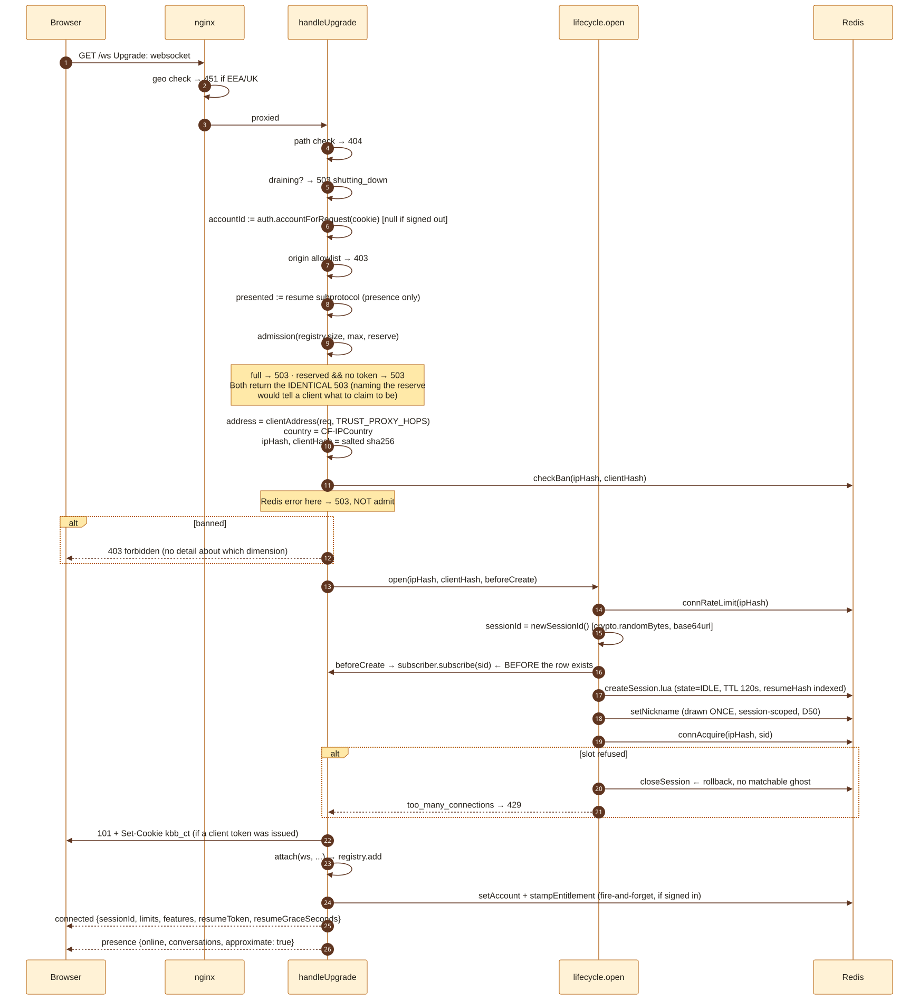

**CONFIRMED** — `backend/src/server.ts:668-908`, `ws/lifecycle.ts:297-343`.

**What is really happening.** Nothing here requires an account, a password or a
token. The handshake is the server deciding whether this connection is allowed
to exist at all, and doing every cheap check before any expensive one.

1. **The country check happens at the edge, in nginx**, so a blocked visitor
   never reaches application code. It is repeated inside *every* location block
   because nginx does not intercept a `return` issued from the server block —
   the page would arrive with an empty body. Found by running it, not reading it.

2. **Identity is two salted hashes, not a login.** The IP address and a cookie
   the server issued, each hashed with a secret salt. Those two hashes are the
   only handle the abuse controls have, and a block records *both* — one
   dimension alone is too easy to shed with a new IP or a cleared cookie.

3. **The last few seats belong to people coming back.** A returning browser and
   a first-time visitor knock on the same door. Refusing a newcomer loses one
   chat that never started; refusing a reconnection destroys a live conversation
   for *two* people, and a busy server is exactly where drops happen. Both
   refusals return an identical 503, because naming the reserve would tell a
   client what to pretend to be.

4. **The subscription is taken out before the session row exists.** The other
   order loses the `matched` event of exactly the people who were quickest —
   the hardest class of bug to reproduce.

5. **A failed slot claim rolls back rather than waiting for a TTL.** For the two
   minutes the row would otherwise take to expire it is a *matchable ghost*: a
   session other people can be paired with, that has no socket behind it.

**And the browser never sees any of these refusals.** They reach page script as
a close with code 1006 — no status, no reason — so "at capacity", "the backend
is down" and "the wifi went away" are indistinguishable. That is the whole
reason `/api/capacity` exists (D64, §28.9).

### Flow C — Enter matchmaking

**The idea in one paragraph.** The problem being solved is not "pick someone
from a list". It is "pick someone from a list while several other servers are
picking from the same list, and never hand one person to two strangers." Redis
runs one script at a time, all the way to the end, before starting another — so
looking at the queue, choosing somebody, and recording the pair are written as
*one script*. There is no moment between "I chose you" and "you are mine" for
another server to slip into. The same work as separate commands from the
application would leave exactly that gap.

**Why each step is what it is:**

1. **You are put into the queue before anything looks at it.** If two people
   arrive in the same instant and both looked first, both would see an empty
   queue and both would wait — for each other.

2. **Eight candidates are sampled at random, not scanned**, and the
   longest-waiting of them wins. Random sampling keeps the cost of a search
   independent of queue size; the longest-waiting tie-break is what stops
   somebody being passed over indefinitely.

3. **A preference is scored, never required** — gender 4, country 2, intent 1,
   and a score of zero is an ordinary stranger. Requiring all three does not
   survive the arithmetic: 15% of one gender × 70% of one country × 20% of one
   vibe is two people in a hundred. The failure would be invisible, because the
   fallback still works — a paying user would simply have a preference that
   never applied.

4. **Blocked candidates are skipped, never removed.** They are blocked relative
   to *this* searcher only, and must stay matchable for everybody else.

5. **Stale entries are cleaned up by whoever walks past them.** A crashed
   instance leaves its people in the queue; rather than a sweeper that has to
   find them, the ordinary path repairs whatever it touches.

See §11.1 for the full sequence. The concurrency-relevant details:

- The **profile, preference and intent are written before the queue is joined.**
  A session queued first can be matched by its own ordinary rules before the
  thing it is paying for has landed — "the user's one selector did nothing on
  the attempt they were watching."
- `preferenceAllowance` is one Lua script: entitlement check (reads
  `premiumUntil` off the session row — never PostgreSQL, D16), then cooldown,
  then hourly token bucket, keyed on the **IP hash read from the session's own
  row** so no caller can name a bucket but its own.
- Every refusal **degrades silently**. There is no frame that could carry it and
  there must not be one.
- `MATCH_RETRY_ATTEMPTS` = 3, and a retry happens **only** when the attempt
  cleaned stale entries or skipped blocked candidates — resampling a genuinely
  empty set finds the same nothing.

### Flow D — Successful match

Covered in §11.1 and §14. **The one trap:** the two `matched` frames are built
in **different places** — the waiting side by `lifecycle.announceMatch`
(published), the side that pressed Start by `server.ts:replyToSearch:1492-1518`
(built from the outcome). Anything added to a match must be added to **both**, or
half of every conversation gets it and which half depends on who was waiting.
`partnerPresence` shipped in one and not the other, and nothing failed.
**CONFIRMED.**

### Flow E — Real-time chat

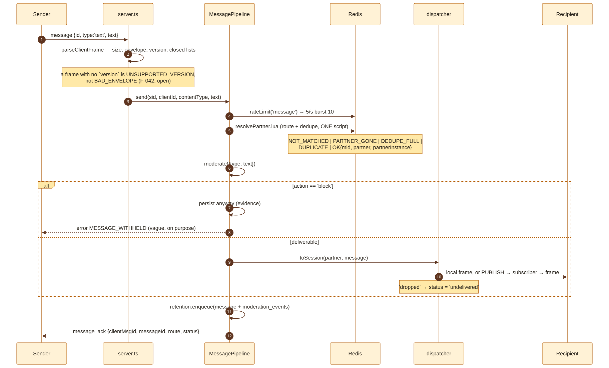

**Failure paths, exhaustively** (`server.ts:replyToMessage:1436-1482`):
`withheld` (not retryable, deliberately vague), `rate_limited`, `duplicate`
(not retryable — retrying is what produced it), `dedupe_full`, `not_matched`.

**No retries anywhere.** No message queue, no store-and-forward, no offline
delivery. **CONFIRMED.**

**Five things that surprise people:**

- **A blocked message is still stored.** The most serious abuse in the system
  used to be the only kind that left no trace, because the code returned before
  reaching the storage step. Delivery is still refused; only the record changed.
- **The receipt is not a read receipt and never was.** It means the server
  accepted the message and routed it. If the partner's socket had just dropped,
  the status says `undelivered`.
- **Messages are not buffered while a partner is away** (D43). Buffering would
  write message text into a Redis key, which I8 forbids without exception. The
  composer is disabled instead.
- **The rules never see a raw string.** Text is normalised first — lookalike
  characters folded, spacing collapsed — so `g mail dot com` and its unicode
  twins trip the same rule.
- **Delivery cannot fail the send.** The dedupe entry is already written by the
  time delivery is attempted, so unwinding would burn a message id for a message
  nobody has.

### Flow F — WebRTC signalling

**Does not exist.** See §13.

### Flow G — Skip

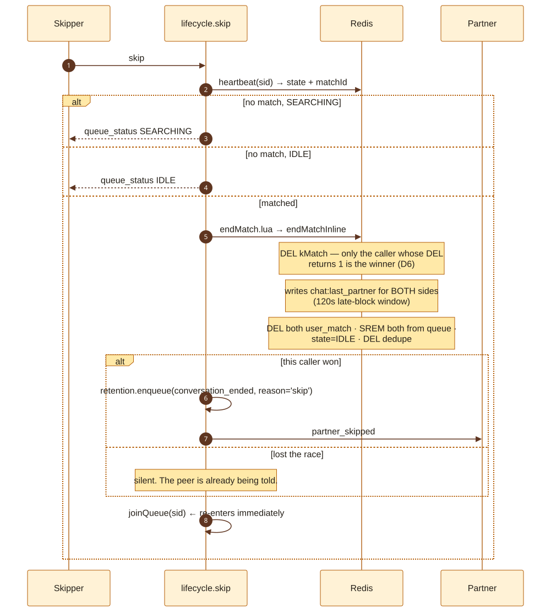

**CONFIRMED** (`ws/lifecycle.ts:542-555`, `924-956`).

**Race handling:** `endMatchInline` is shared by five scripts (`endMatch`,
`blockPartner`, two janitor scripts, `closeSession`'s path) so "a match ends"
means exactly one thing in Redis regardless of who noticed first. Its extra
arguments are passed **explicitly by every caller**, never read as "the last
ARGV" — an implicit convention across five call sites is a trap for whoever adds
the sixth.

**`skip` vs `leave_chat`:** `skip` re-queues and can re-match before the client's
next frame is read, so a client trying to leave with `skip` + `leave_queue`
loses the race whenever somebody is waiting. `leave_chat` exists for that.
**`block` returns to IDLE, never the queue**, and auto-search must never fire
after a block (D39).

**Why the teardown looks like this.** Two people can press Next in the same
instant, and exactly one of them must be the side that notifies, or the survivor
is told twice that the conversation ended. `DEL kMatch` is the referee: only one
caller can be the one whose delete actually removed the record, and that caller
is the only one that speaks. Everyone else gets `ALREADY_ENDED` and treats it as
success.

**Why each side's hashes are kept for two minutes afterwards.** Blocking races
teardown constantly — somebody sends something abusive and immediately skips, so
the victim's block arrives after the match is already gone. Without
`chat:last_partner`, that block finds no match, records nothing, and the user is
told nothing went wrong: they believe they blocked somebody they did not (D38).

**Why the other side is never told which of the three happened.** A skip, a
deliberate leave and a block all produce an identical `partner_skipped`. A
distinct "you were blocked" signal tells an abusive user exactly which behaviour
got them blocked, and by whom.

### Flow H — Disconnect / reconnect


**CONFIRMED** (`redis/scripts.ts:closeSession`, `ws/lifecycle.ts:694-745`).

| Scenario | Behaviour |
|---|---|
| **Normal close / refresh** | Seat held 20s. Partner told `partner_reconnecting` with an `until`. Resume restores the conversation *with* the `connected` frame, not a moment later |
| **Network drop / mobile handover** | Identical. This is what the grace window is for |
| **App backgrounded** | Heartbeat stops → 120s session TTL, but the 20s detached TTL wins once the socket closes |
| **Backend restart (graceful)** | `server_shutdown` to every socket, then close 1001. Sessions torn down through the ordinary path so **every partner is released**, not left waiting out a TTL |
| **Backend SIGKILL** | Nothing runs. TTLs + janitor are the whole recovery net |
| **`RESUME_GRACE_SECONDS=0`** | Restores the pre-§28 D7 behaviour. **Supported, not dead** — the teardown tests run against it |
| **Client reconnect** | Jittered backoff curve from `VITE_*` config; `withJitter` on a monotonic base. On a *failed* attempt only, `probeCapacity()` fetches `/api/capacity` once — never polled |

**Two subtleties that cost real bugs:**

- A browser **never sees the 503** on a refused handshake — it gets close 1006,
  identical to a dead backend and to dropped wifi. `/api/capacity` is the only
  place that difference exists, and it answers **200 even when busy** (a 503
  would be indistinguishable from the outage the caller is ruling out) and
  carries no count, no ceiling and no instance id.
- **"Connection lost" is a lie on a first connection.** `socket_closed` carries
  `everOpened`; a refused handshake suppresses the toast. No test could have
  caught this — every test that constructs a `socket_closed` was written about a
  conversation that dropped.

### Flow I — Moderation / reporting

Covered in §15. **Synchronous** on the message path (regex, in-process,
sub-millisecond). **Asynchronous** only in the sense that the evidence write is
write-behind, and that a human triages later via the console.

Console review path: operator authenticates (scrypt + TOTP) → opens a report →
**the audit row is written first, in the same transaction** → transcript is
selected. A test breaks the audit insert and asserts **no transcript comes
back**. The guarantee is "a read that was not logged did not happen" (D33).


**Three things to understand about the pair:**

1. **A report the system could not record is not acknowledged.** The user gets
   an error and is asked to retry. Telling somebody asking for help that their
   report was filed when it was not is the one lie this system refuses to tell
   (§14.3).
2. **You never name who you are reporting.** You are never told a partner's
   session id in the first place, and a request that could name its own subject
   could name somebody else's.
3. **A block and a ban must never share a namespace.** If they did, a moderator
   lifting a ban would silently delete a user's own protection — there is a test
   for exactly that (D29).

### Flow J — Conversation lifecycle

See §14.

---

## 18. State Machines

### 18.1 Session (Redis `state` field) — **CONFIRMED**


**Timeout transitions:** session TTL 120s (heartbeat every 20s — `assertCoherent`
refuses a heartbeat that is not comfortably below it); match TTL 3600s; detached
20s; late-block window 120s.

### 18.2 Connection (socket) — **CONFIRMED**


### 18.3 Client screen (`frontend/src/state/machine.ts:43`) — **CONFIRMED**

`connecting → idle → searching → chatting → ended → disconnected`

The header comment states the invariant: **"This state is a *mirror*, not a
source. It never decides that it is matched."** Optimistic transitions exist
(`searchPending`) and are rolled back by the authoritative `queue_status`.

### 18.4 Circuit breaker (`storage/breaker.ts`) — **CONFIRMED**


**The arithmetic that binds two settings together:** reaction time is
`BREAKER_FAILURE_THRESHOLD × DATABASE_STATEMENT_TIMEOUT_MS` — **50s at the
defaults**. That is the outage that must elapse before the spool comes into
play. Change one and the other needs revisiting.

### 18.5 WebRTC state machine

**Does not exist.** See §13.

---

## 19. Concurrency & Distributed Systems

### 19.1 The scorecard

| Hazard | Status | Mechanism |
|---|---|---|
| **Double matching** | **Prevented** | One Lua script per transition; caller queued before it scans (D4) |
| **Duplicate matchmaking entry** | **Prevented + self-healing** | `joinQueue` while SEARCHING re-`SADD`s a reaped entry |
| **Stale queue entries** | **Repaired continuously** | Every `tryMatch` scan `SREM`s what it walks over; `janitorQueue` covers a queue nobody is scanning |
| **Stale sockets** | **Bounded** | 120s session TTL + heartbeat; `janitorSessions` |
| **Double conversation-end** | **Prevented** | `DEL kMatch` returns 1 for exactly one caller (D6) |
| **Duplicate message delivery** | **Prevented** | `SADD` on the dedupe set is inside the routing script (I14) |
| **Split-brain** | **N/A** | Single Redis. Sentinel promotes; ioredis reconnects on `READONLY` |
| **Distributed locks** | **Two, deliberately separate** | `janitor:lock`, `deletion:lock` — so they never contend |
| **Idempotency** | **Rule 4, systematically** | Repeat skip, repeat close, repeat join, repeat block, repeat save all converge |
| **Clock skew** | **Eliminated on the fairness path** | Every script reads Redis `TIME`, never a host clock |
| **Message ordering across a pair** | **Not guaranteed** | **INFERRED.** Per-sender FIFO only |
| **Pub/Sub delivery** | **At-most-once, by design** | Every event reports already-committed state |
| **Cache invalidation** | **Convergent, not invalidated** | Bans/spend/premium are re-derived at boot and on an interval |

### 19.2 Races that are real and accepted

1. **The persona dispatch window.** Between the supervisor deciding to dispatch
   and the persona's `join_queue` landing, a second human can arrive. The code
   says so plainly: "that race cannot be closed from the client side." The window
   is made small and the persona **withdraws** when it loses.
2. **A block racing a teardown.** Mitigated by the 120s `last_partner` record,
   not eliminated.
3. **`announceMatch` racing an immediate end.** `saveMatchIdentities` returns
   `match_gone` → **nobody is told they matched**, reported as idle. Announcing
   into a finished conversation would paint a live-looking transcript whose very
   next command returns `NOT_MATCHED`.
4. **`stampEntitlement` is fire-and-forget**, so a search arriving before it
   lands searches without a preference — the same degraded answer every other
   limit gives.

### 19.3 The one structural limitation

**KEYS vs ARGV.** Scripts derive keys inside themselves (a candidate's session
row is not knowable until something has been read). That is safe **only because
this is a single Redis, not a Cluster** (D13) — Cluster requires every key up
front for slot routing. **This is the hard ceiling on Redis scaling** and is
stated in `redis/scripts.ts:16-24`. **CONFIRMED.**

---

## 20. Failure & Recovery

*"What happens if this component disappears right now?"*

| Component | Detection | User-visible | Data consistency | Recovery |
|---|---|---|---|---|
| **Redis** | `clients.health()` → `/ready` 503 → out of the LB | **Total outage.** No sessions, no matching, no delivery | Sessions/matches lost (persistence off, D12). PG rows survive | ioredis reconnects; janitor + TTLs converge. **Measured failover: ~11.2s, 0 backend restarts, 346 message positions agreeing across 113 conversations** |
| **PostgreSQL** | Breaker opens after ~50s of timeouts | **None.** Chat is unaffected — `/ready` reflects Redis only | Records go to the **disk spool**; drained on recovery. Overflow drops are counted and alerted | **Measured: 43.5 msg/s during the pause, 43.7 after; client lag p99 22.8–23.0ms with no visible step** |
| **One backend instance** | Beacon lapses; janitor reaps | Its sockets drop → client reconnects (backoff + capacity probe) | Partners released by `janitorMatches`, which returns survivors to notify | Automatic |
| **Graceful deploy** | `draining=true` immediately | `server_shutdown` then 1001; **seats are not held** (a shutdown is not a blip) | Every match ended through the ordinary path | `SHUTDOWN_TIMEOUT_MS` drain loop, then `closeAllConnections()` |
| **nginx** | Caddy 502 | Total | None | restart |
| **Caddy** | — | Total, no TLS | None | restart |
| **Personas process** | none in-band | Personas vanish | None | Chat is untouched — that is why it is a separate process |
| **Console** | none | Moderation stops | None | Chat is untouched |
| **Model provider** | `stop: 'error'` | Persona falls back to the **scripted voice** | None | **This is the dangerous one** — the failure does not look like one. Spend stays near zero and the only symptom is lower-quality replies |
| **Spool disk full** | `chat_spool_*` metrics | None | Records dropped, counted | Bounded by design. **The spool is not durable storage** |
| **Backup host** | `BackupMonitor` → `chat_backup_last_success_timestamp` | None | — | Alert |

**Two failure-handling patterns worth naming:**

- **`transaction()` never rolls back down a connection that never answered.**
  It checks whether PostgreSQL produced a SQLSTATE; an error without one was
  manufactured by the driver after it gave up, so the connection is **destroyed**
  rather than released. Rolling back anyway costs a second full timeout — that
  doubling (F-031) is what kept the breaker shut through a 60-second outage and
  made the spool unreachable.
- **A batch being refused is not every record in it being refused.** Both write
  paths narrow to individual rows via `salvage`. F-032: one message whose
  conversation row had not landed yet used to destroy every record sharing its
  batch — **1,350 P0 records in a single chaos run.**

**The dominant unmitigated risk (F-033):** Redis is a single point of failure.
Sentinel is built, tested and drilled under load. What remains is not code — it
is a second machine.

---

## 21. Observability

### 21.1 What exists — **CONFIRMED**

**Metrics:** 90 `chat_*` Prometheus series (`backend/src/metrics/registry.ts`,
1,046 lines) covering connections, matchmaking (attempts/failures/latency/queue
depth/composition), messages (received/delivered/rejected/delivery latency),
moderation, reports, blocks, enforcement, retention (queue depth/dropped by
class/flushed/backlog/deleted), spool, DB breaker + write latency + failures by
SQLSTATE, auth, connections/reconnects, preference (applied by dimension /
limited / widened), the **product funnel**, conversation duration and message
counts, cost model, capacity probes, and 16 persona series.

**Logs:** structured JSON via `src/logger.ts` with a **recursive field denylist
that throws outside production**; nginx emits `kbb_access` JSON; Alloy ships to
Loki; `npm run verify:logs` reads back and fails on addresses, credentials and
denied field names.

**Traces:** OpenTelemetry → OTLP → Tempo. HTTP + `pg` + `ioredis` instrumented,
started from a `--require` preload. Exporter-side attribute denylist.

**Dashboards + alerts:** Grafana + Alertmanager, both in the compose stack.

### 21.2 The eight observability rules this codebase learned the hard way

Each of these cost a real incorrect reading. They are the most transferable part
of the repository.

1. **`metrics-wiring.test.ts` fails any metric declared and never written.** A
   declared-and-dead metric is worse than an absent one: it is charted, it reads
   zero, and it is believed.
2. **A documented dead *label* is worse than a dead metric.**
   `chat_profiles_refused_total{reason="age_below_minimum"}` was documented as a
   count of under-18 declarations and written by nothing (F-038) — the refusal
   pooled into `chat_invalid_frames_total{reason="invalid"}` with malformed JSON.
3. **A guard a type annotation satisfies proves nothing.** The first version of
   the dead-label check passed with the write site deleted, because the literal
   also appears in a parameter type. Match a call argument, then **watch it fail**
   before keeping it.
4. **Zero-initialise every closed label set.** A safety series that only appears
   on first use reads as "never happened" — and a `p0` retention-drop series
   appearing for the first time *is* safety evidence being lost.
5. **`chat_retention_backlog` is deliberately NOT zero-initialised.** A zero
   backlog from a monitor that could not read the database is the most
   reassuring thing this process could wrongly claim.
6. **A span processor must never throw.** `onEnd` runs synchronously inside the
   operation being measured, so a throw propagates into the database call it was
   watching — the load stack went into a restart loop and the thing crashing it
   was the safety control (F-040).
7. **`| json` in LogQL promotes every field to a label**, including per-request
   ones. Name the fields you want.
8. **Prometheus stores `le="0"` as `le="0.0"`**, and PromQL rejects `\.` as a
   string escape. Served and stored are different artifacts — the same family as
   the stale-bundle trap.

### 21.3 Gaps — **CONFIRMED**

| Gap | Why it matters |
|---|---|
| **Tracing is off, and Tempo runs anyway** | `TRACING_ENABLED` defaults false and no production file sets it (§5.2). Everything below about traces describes a pipeline that is built and idle. Nothing distinguishes an empty trace store from a quiet one — the F-041 symptom, reached through configuration this time |
| **The WebSocket message path is not traced** | Stated rather than fixed: a socket is one HTTP request that never ends. The cross-instance conversation flow is read from metrics and logs |
| **No correlation id across the socket** | `sessionId` and `matchId` appear in logs, but there is no per-frame trace context |
| **No RUM / client-side telemetry** | Deliberate — the privacy policy says the browser makes no third-party requests |
| **cAdvisor sees only the root cgroup on Docker Desktop/WSL2** | Per-container series absent in dev |
| **Funnel denominators** | `chat_connections_total` counts sockets *including resumptions*, `chat_matches_created_total` counts pairs. A funnel assembled from those is a ratio across three denominators — wrong in a direction no graph shows. `chat_funnel_total` exists precisely so the unit stays "one session, one search" |

---

## 22. Scalability Analysis

### 22.1 Measured, not estimated

**CONFIRMED** — `docs/testing/RESULTS.md`.

| Concurrent (1 vCPU / 2 GB) | ack p50 | ack p95 | ack p99 | match p99 | messages/60s |
|---:|---:|---:|---:|---:|---:|
| 1,000 | 10 ms | 90 ms | **150 ms** | 428 ms | 6,087 |
| 2,000 | 55 ms | 314 ms | **598 ms** | 1,617 ms | 12,245 |

At 2,000 the four containers demanded **125.6% of one core** and only 100%
exists. Nothing was OOM-killed, nginx never exhausted `worker_connections`, the
ephemeral port range was never approached. **The knee is between 1,000 and
2,000, and the bottleneck is CPU, established by elimination.**

Memory at 2,000 concurrent: nginx **4.1 MiB** idle / 57.2 MiB loaded, backend
29.9 / 74.2 MiB, total ~222 MiB. **~36 KB per active user.** Ten thousand users
is ~360 MB, which fits the 1 GB tier. **CPU stops this service long before
memory does.**

Two plausible levers were measured and both did nothing: a mostly-idle
population saved only 23%, and doubling `HEARTBEAT_INTERVAL_MS` to 40s moved
nothing outside run-to-run noise. **~85% of the cost is connection maintenance
rather than conversation** — an idle user is cheap on memory (9 KB) and nearly
as expensive as an active one on CPU.

### 22.2 Projection by tier

| Concurrent | HTTP/WS | Matchmaking | Redis | PostgreSQL | Verdict |
|---|---|---|---|---|---|
| **1,000** | 1 vCPU, ack p99 150 ms | fine | trivial | ~5 rec/s | **Runs today, measured** |
| **10,000** | **6–8 vCPU** (extrapolated from 1.26 cores at 2,000; a floor, since contention worsens) | fine — sampling is O(sample), not O(queue) | single node fine | ~50 rec/s | Needs a bigger box + ≥2 backend replicas. **ASSUMPTION** |
| **100,000** | ~30–60 vCPU across many instances | fine | **single Redis becomes the ceiling** — and Cluster is blocked by the KEYS/ARGV design (D13) | ~500 rec/s, batched — fine | Needs the Redis decision in §24 |
| **1,000,000** | Multi-region | Queue segmentation mandatory | Sharded, which this code cannot do today | Partitioned `messages` | Architectural rewrite of the state layer |

### 22.3 The hard ceilings, named

1. **The edge source-port ceiling.** There is no `upstream` keepalive pool,
   because `proxy_pass` targets a *variable* so Docker's DNS is re-resolved for
   a replaced replica. Every WebSocket therefore opens its own TCP connection to
   the single address `backend:8080`; with three of the four tuple members fixed,
   the source-port range caps it at ~64k even widened to 1024–65535. **That is
   ~32,000 people per edge**, and going past it needs a second backend address or
   a unix socket. **CONFIRMED** — architectural, not financial.
2. **Redis Cluster is blocked by design** (§19.3).
3. **The load harness dies before the server above ~2,500 bots**, so figures
   beyond that are extrapolation, clearly labelled.

### 22.4 What does *not* bottleneck

Matchmaking cost is **O(sample), not O(queue depth)** — `SRANDMEMBER` of 8 (or
32 on escalation) plus one `HMGET` each. Queue depth affects the *quality* of
matching, not its cost. **CONFIRMED.**

---

# TARGET STATE

Everything above describes what exists. Everything below is proposal.

## 23. Current Architecture Problems

Ranked by expected damage.

| # | Problem | Severity | Evidence |
|---|---|---|---|
| **P1** | **Redis is a single point of failure for the entire service** — *as deployed*, not as built. Persistence is off, so a restart loses every session and match; `/ready` derives from Redis alone, so all instances leave the LB together. Sentinel support is implemented, guarded three ways at startup and drilled under load (§5.1) — it is simply **not switched on**: `REDIS_SENTINELS` is empty in `docker-compose.prod.yml` and commented out in `.env.prod.example`, and every production boot warns about exactly this | **Critical** | F-033; §5.1 |
| **P2** | **Single backend replica, single host, single region.** No multi-AZ, no autoscaling, no orchestrator. The code is horizontally scalable; the deployment is not | **High** | `replicas: 1` |
| **P3** | **The edge cannot exceed ~32,000 connections** because `proxy_pass` targets a variable and there is no keepalive upstream pool | **High** | RESULTS.md:316-323 |
| **P4** | **Redis Cluster is architecturally foreclosed** by scripts deriving keys internally (D13) | **High at ≥100k** | `scripts.ts:16-24` |
| **P5** | **The brief's audio/video requirement is entirely unimplemented** | **High (product)** | §13 |
| **P6** | **The model-provider failure mode is silent.** A persona falls back to the scripted voice; spend stays near zero and the only symptom is lower-quality replies | **Medium** | `personas/client.ts` |
| **P7** | **No message ordering guarantee across a pair**, and nothing documents it as a contract | **Medium** | INFERRED |
| **P8** | **`TRUST_PROXY_HOPS` cannot be validated, only measured**, and a wrong value weakens per-address rate limits and blocks | **Medium** | `security:probe` reports INFO |
| **P9** | **An env file is delivered whole**, so the app container holds credentials it never reads (known limitation) | **Medium** | stated in `.env.prod.example` |
| **P10** | **`DATABASE_SSL: false` in prod** — safe only while Postgres is on the same host | **Medium** | `docker-compose.prod.yml` |
| **P11** | **Payments schema is staged, not applied.** Turning `PAYMENTS_ENABLED` on without `011_payments.sql` makes every order fail while the routes exist — reads as a broken integration rather than a missing table | **Medium** | `migrations-pending/` |
| **P12** | **Blocking does not bound a spammer**: a block protects the blocker only | **Medium (product)** | FINDINGS.md accepted |
| **P13** | **No secret manager, no mTLS, no internal authn between services** | **Low today, Medium at multi-host** | |
| **P14** | **F-042 / F-043 open protocol defects**: structural garbage reported as `UNSUPPORTED_VERSION`; `join_queue` while matched answers with silence, leaving a deliberate re-join waiting forever | **Low** | FINDINGS.md:14-19 |
| **P15** | ~~The moderation console has no container.~~ **Fixed.** An `admin` service now runs `dist/admin/main.js` from the backend image, behind the `admin` profile, bound to host loopback and connecting as `karobakbak_console` | **Resolved** | §5.2, OPERATIONS §7e |
| **P16** | **Tempo is deployed and receives nothing.** `TRACING_ENABLED` defaults false and no production file sets it, so an empty trace store is indistinguishable from a healthy idle one — the F-041 symptom, reached through configuration instead of start-up order | **Medium** | §5.2 |
| **P17** | **A subsystem's existence in the repository says nothing about whether it is running.** Six of them are off, absent or unfed, each for a different and defensible reason, and nothing enumerates that in one place except §5.2 — which is a document, not a check | **Medium** | §5.2 |

**These are ranked by the Severity column, not by position** — P15 and P16 were
found after the first fourteen were written, and renumbering would break the
references to P1 elsewhere in this document.

**What is explicitly NOT a problem**, and should not be "fixed":

- The Lua-heavy design. It is why concurrency is correct.
- The write-behind retention path being lossy under overflow. That is D16.
- The modular monolith. See §24.1.
- Silent preference degradation, undisclosed refusals, the hidden presence
  counter. All deliberate, all reasoned, all tested.

## 24. Target Architecture

### 24.1 Do **not** decompose into microservices

**RECOMMENDATION.** The three-process split is already drawn on the only
boundary that pays: **credential separation**. Chat holds no model key and no
console credential; personas hold the model key; the console holds operator
credentials and a different DB role.

Splitting "matchmaking" into its own service would achieve nothing, because
matchmaking state is *already* external (Redis) and matchmaking logic is
*already* atomic (Lua). It would add a network hop to the latency-critical path
and buy no isolation that does not already exist.

**Keep the monolith. Scale it horizontally.**

### 24.2 Target topology


### 24.3 The changes, ranked, each with its trade

| # | Change | Problem | Why it helps | Complexity | Op cost | Migration | Needed |
|---|---|---|---|---|---|---|---|
| **T1** | **Redis replica on a second host + 3 Sentinels** | P1 | Turns a total outage into ~11.2s (measured, §5.1). **No code is written for this** — the client branch, the startup guards, the drill rig and the layered stack all exist. It is `REDIS_SENTINELS` filled in, plus a host | **Low**, and lower than it looks | +1 small host | None — blank `REDIS_URL`, set the three sentinels, restart | **Now** |
| **T2** | **`backend` to ≥2 replicas** | P2 | Removes the single process; the code is already correct for it (`no-instance-addressing.test.ts`) | **Low** | none | None | **Now** |
| **T3** | **Apply `011_payments.sql` or hard-gate the flag** | P11 | A missing table must not read as a broken integration | Trivial | none | one migration | **Now** if payments ship |
| **T4** | **Re-measure `TRUST_PROXY_HOPS` against the running stack** and record it beside the deployment | P8 | Blocks and rate limits are only as good as this number | Trivial | none | none | **Now** |
| **T5** | **nginx `upstream` block with keepalive + multiple backend addresses** | P3 | Removes the ~32k source-port ceiling. Trade: loses variable-target DNS re-resolution, so replica replacement needs a reload or `resolver` in the upstream | Medium | reload discipline | none | **At ~20k** |
| **T6** | **Redis Cluster readiness: pass every key in `KEYS`** | P4 | Unblocks sharding. Trade: every script's arity changes and **every matchmaking race must be re-verified** — the most expensive change in this table | **High** | high | staged, script by script | **At ~100k, not before** |
| **T7** | **Postgres read replica + partition `messages` by month** | scale | Console reads stop touching the write primary; deletion becomes `DROP PARTITION` | Medium | +1 host | online | **At ~50k** |
| **T8** | **Secret manager for the two credentials the app never reads** | P9 | Removes the superuser password from the socket-facing process | Low | small | env split | **Now-ish** |
| **T9** | **`DATABASE_SSL` on once Postgres leaves the host** | P10 | — | Trivial | none | with the move | **When it moves** |
| **T10** | **Explicit ordering contract** — either document per-sender FIFO as the guarantee, or add a per-conversation sequence in the `message` event | P7 | Removes an unstated assumption before a client depends on it | Low (document) / Medium (sequence) | none | protocol note | **Now** (document) |
| **T11** | **A liveness signal for the model provider** — alert on `scripted_fallback_rate`, not on spend | P6 | Makes a silent failure loud | Low | none | none | **Before personas go live** |
| **T12** | **WebRTC** | P5 | See §24.4 | **Very high** | very high | new subsystem | **Only if the product decision is made** |
| **T13** | ~~Give the console a deployment~~ **Done.** | P15 | Closes the gap between alerting that reports are ageing and being able to work them | **Done** | none | OPERATIONS §7e | **Done** |
| **T14** | **Decide tracing: turn it on, or stop running Tempo** | P16 | Either fixes it. Running the store while feeding it nothing is the only option that misleads | **Trivial** | none either way | none | **Now** |
| **T15** | **A start-up capability line, and a `chat_capability` gauge** | P17 | The process already knows every flag at boot and already logs warnings about several. One line naming what is on, and a labelled gauge, makes §5.2 checkable instead of trusted — the same argument that produced `chat_cost_model_configured` | **Low** | none | none | **Now** |

### 24.4 If audio/video is genuinely required — **RECOMMENDATION**

This is not a small addition. It is a **second product** with a second threat
model, and it collides with several decisions this codebase made deliberately.

**What it would need:**

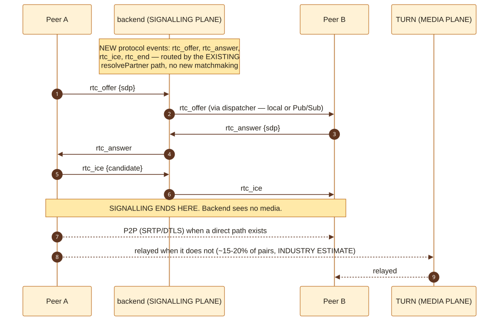

**Design constraints this codebase already imposes on such a feature:**

1. **Signalling rides the existing socket.** Offer/answer/ICE are just three
   more session events routed by `resolvePartner` — no new matchmaking, no new
   Lua, no new state machine in Redis. That is cheap and correct.
2. **Media must never traverse the backend.** Binary frames stay rejected; media
   goes *beside* the socket, never through it. A `coturn` deployment with
   **short-lived HMAC credentials minted per match** (never static credentials)
   is the only shape that fits the existing auth model.
3. **The moderation model does not transfer at all.** The eight regex rules
   judge text. There is no equivalent for a video stream that does not involve a
   third-party processor — which is a **privacy-policy change and a new data
   processor**, not a config change (the policy names the model provider
   individually and requires terms forbidding training on submitted content).
4. **The retention model does not transfer.** `messages.body` is text. Retaining
   media means object storage, which §23 explicitly rejects.
5. **The child-safety position changes materially.** Child safety today relies
   on a client-side age gate plus reporting and moderation, with stronger
   measures on the roadmap. Text-only is load-bearing for that position.
6. **TURN bandwidth is the new cost driver**, and it is billed per GB rather
   than per vCPU — which breaks the cost deck's "provisioned, not consumed"
   rule that `MODEL_PRICES` and the recording rules are built on.

**Recommendation: treat this as a separate product decision with its own design
document, not as a feature request against this architecture.** If it proceeds,
signalling is a two-week addition and everything else is the year.

## 25. Technology Recommendations

Only where a change is actually warranted. **Keep** is a recommendation too.

| Layer | Today | Recommendation | Reason |
|---|---|---|---|
| CDN/edge | Cloudflare (inferred) | **Keep**, and version-control the WAF rules | `CF-IPCountry` is already load-bearing for both geo-blocking and the declared country |
| TLS | Caddy 2.8 | **Keep** | ACME automation, tiny footprint, correct `trusted_proxies` for Cloudflare ranges |
| Reverse proxy | nginx | **Keep**, add an `upstream` block (T5) | 4.1 MiB idle. Nothing beats it here |
| Load balancing | none (single replica) | **nginx upstream first; a managed L4 LB only at multi-host** | Avoid an API gateway — there is no API to gate. Three JSON routes and a socket |
| API gateway | none | **Do not add one** | It would add a hop to a latency-critical path and gate nothing |
| WebSocket infra | `ws` in-process | **Keep** | Measured at 22 KB/active connection. A dedicated gateway would add a hop and re-implement admission bands |
| Matchmaking | Redis + Lua | **Keep. Do not rewrite.** | This is the best-engineered part of the system |
| Cache/state | Redis 7 single node | **Sentinel now (T1). Cluster only at ~100k (T6)** | Cluster costs a re-verification of every matchmaking race |
| Message broker | none | **Do not add one** | Pub/Sub is correct for notifications about already-committed ephemeral state. Streams were considered and rejected with reasons |
| Event streaming | none | **Do not add** | Nothing needs replay |
| Database | PostgreSQL 16 | **Keep.** Add a replica + monthly partitions at ~50k (T7) | Deletion becomes `DROP PARTITION` instead of a batched delete |
| Object storage | none | **Do not add** unless media ships | §23 |
| STUN/TURN | none | `coturn`, HMAC-timed credentials — **only with T12** | |
| Observability | Prom + Loki + Tempo + Grafana + Alertmanager | **Keep** | Measured cost: **~4.4% of a core and 231 MiB**, on a tier where the app peaks near 222 MiB. That is honest and acceptable |
| Moderation | 8 in-process regex rules | **Keep as the synchronous layer.** Any classifier goes **async, off the hot path**, and is a privacy-policy change | The current design's virtue is that it is deterministic and testable |
| Orchestration | docker compose | **Keep until multi-host.** Then a managed container service, **not** self-hosted Kubernetes | One operator. K8s is a second full-time system |
| Secrets | env files | **Docker/compose secrets or SOPS** (T8) | Cheapest fix for P9 |

## 26. Architecture Trade-offs

| Trade | Chosen | Given up | Verdict |
|---|---|---|---|
| Lua vs application-level locks | Lua | Debuggability, Redis Cluster | **Right.** Correctness under concurrency was the goal |
| Pub/Sub vs Streams | Pub/Sub | Durable notification | **Right.** Every event reports committed state |
| Write-behind vs synchronous retention | Write-behind | Guaranteed persistence under overflow | **Right, and stated plainly** rather than hidden |
| Redis persistence off | Off | Session survival across restart | **Right for sessions, and correctly compensated** for bans/spend/premium by replay-at-boot |
| Session-scoped nickname (D50) | Session | §24.3's "no handle stable across matches" | **Defensible.** A session dies with the tab; the cost (two people matched twice can tell) is stated |
| No JWT library | Hand-written | Battle-tested code | **Acceptable only because every failing case is tested.** This is the highest-variance decision in the codebase |
| Text-only | Text-only | The product in the brief | **The single biggest gap between brief and implementation** |
| Monolith | Monolith | Independent deploy of subsystems | **Right at this scale** |
| Single host | Single host | Availability | **Wrong now.** T1 + T2 |
| No proactive abuse detector | None | Bounding a spammer | Deliberate purpose-scope decision, with the measured cost recorded |

## 27. Architecture Decisions (ADR-style)

The repository already carries ~64 decision records in `DESIGN.md` (D1–D64) plus
12 persona records. **These are the ones a new engineer must read first**,
restated with their consequences.

---

**ADR-1 · Redis is authoritative for all matchmaking state (D1)**
*Context:* N backend instances mutating shared state; Node's single thread is not
a concurrency argument across processes.
*Options:* application locks · optimistic retry · Lua · a matchmaking service.
*Chosen:* every transition is one Lua script.
*Trade-off:* Redis Cluster is foreclosed (D13); Lua is harder to debug; a
backtick in a Lua comment is a syntax error several lines from the cause.
*Consequence:* double-matching is structurally impossible. This is the property
everything else depends on.

---

**ADR-2 · The channel name is the routing key (D8)**
*Context:* deliver an event to whichever instance holds a socket.
*Options:* routing table in Redis · consistent hashing · sticky sessions ·
per-session channel.
*Chosen:* `chat:ev:session:{sid}`, subscribed before the session row exists.
*Trade-off:* one Redis subscription per live session.
*Consequence:* **nothing can go stale**, because there is no table. Instance
addressing is impossible by construction and there is a test named after it.

---

**ADR-3 · Retention is write-behind and lossy under overflow (D16)**
*Context:* a database outage must not become a chat outage.
*Options:* synchronous insert · async fire-and-forget · bounded queue + breaker +
spool.
*Chosen:* the third; `/ready` reflects Redis only.
*Trade-off:* evidence can be lost, and every drop must be counted and alerted.
*Consequence:* **measured** — 43.5 msg/s during a PostgreSQL pause vs 43.7 after,
with no visible step in client lag.

---

**ADR-4 · A dropped socket no longer ends a conversation (D42, reverses D7)**
*Context:* mobile networks drop constantly; ending a chat on every blip is hostile.
*Chosen:* `closeSession` marks the session detached and lets the row's TTL be the
grace window; the janitor already ends a match whose side vanished, so there is
**exactly one expiry mechanism**.
*Trade-off:* messages sent during the gap are acked and dropped (D43) — buffering
would write message text to a Redis key, which I8 forbids.
*Consequence:* `RESUME_GRACE_SECONDS=0` restores D7 and is a supported, tested
path. `instanceId` must never be cleared on detach — an empty one reads as
`PARTNER_GONE` and destroys the thing the window protects.

---

**ADR-5 · The last 5% of the connection ceiling belongs to resumptions (D63)**
*Context:* a returning browser and a first-time visitor arrive through the same
upgrade, so the busiest moment refused the resume token §28 exists to honour.
*Chosen:* three admission bands. The refusal in the reserved band sits **after**
`lifecycle.resume`, so inventing a subprotocol costs one Redis lookup and ends in
the same 503.
*Trade-off:* 5% of capacity.
*Consequence:* a refused resumption destroys a live conversation for *two* people
where a refused arrival loses one that never started.

---

**ADR-6 · A preference is scored, never required (D44)**
*Context:* a paid "match me with X" is a scanning tool (D37).
*Chosen:* weights gender 4 / country 2 / intent 1, highest wins, longest-waiting
breaks a tie, **zero is the ordinary candidate**. Two IP-keyed limits bound
hunting rather than flooding.
*Trade-off:* the preference is a preference and can miss.
*Consequence:* requiring all three does not survive the arithmetic — 15% × 70% ×
20% is two people in a hundred. The failure would be invisible, because the
fallback still works.

---

**ADR-7 · A persona is an ordinary client (D-AI-6)**
*Context:* seeding a marketplace without corrupting matchmaking.
*Chosen:* a real socket, the ordinary queue, the ordinary `tryMatch`.
*Trade-off:* an unclosable dispatch race, stated honestly.
*Consequence:* blocks, bans, rate limits, moderation and retention apply to
personas **without anybody writing code to make them apply.**

---

**ADR-8 · A block is not keyed on a session id (D18)**
*Context:* session ids are per-connection.
*Chosen:* salted IP hash **and** client token hash, both dimensions, both
directions, checked inside `tryMatch`; a blocked candidate is skipped, never
removed.
*Consequence:* a session-keyed block would expire the instant the blocked user
reconnected. Blocks and bans keep separate namespaces so revoking a ban cannot
silently delete a user's own protection.

---

**ADR-9 · The console is a separate process with a separate database role (D32)**
*Context:* the console can read every retained conversation; chat needs none of
that.
*Consequence:* `karobakbak_app` is denied `admin_accounts`; `karobakbak_console`
cannot delete a conversation. **Both asserted against real PostgreSQL.** The
audit row is written before the content is selected, in the same transaction
(D33) — a test breaks the audit insert and asserts no transcript comes back.

---

**ADR-10 · Message content never leaves the trusted boundary (D15 + I8)**
*Context:* there is no application-level encryption.
*Chosen:* a recursive logger denylist that **throws outside production**, an
exporter-side span denylist, a no-content metric rule, and a detector that reads
back from Loki.
*Trade-off:* the live persona feed everybody asks for cannot be built.
*Consequence:* this is the **primary** control, so changes to `logger.ts` are
security changes.

---

## 28. Migration Roadmap

| Phase | Work | Unblocks | Risk |
|---|---|---|---|
| **0 — now, days** | T1 Redis replica + 3 Sentinels on a second host (**static addresses** — a name that disappears with the thing it names puts Sentinel into TILT, where it silently never votes) · T2 two backend replicas · T4 re-measure `TRUST_PROXY_HOPS` · T10 document the ordering contract · T11 model-provider fallback alert · **T14 settle tracing** · **T15 the capability line** | Availability, and being able to moderate | Low. Almost none of it is code |
| **1 — weeks** | T8 secret split · T3 payments schema decision · F-042/F-043 protocol decisions · run `npm run test:integration` before anything that adds a table (the table-enumeration guard needs real PostgreSQL and is **not** in `npm run verify`) | Launch readiness | Low |
| **2 — at ~10k concurrent** | Vertical to 8 vCPU · 3–4 backend replicas · T5 nginx upstream + keepalive · Postgres connection-pool retune | 10k | Medium — T5 changes DNS re-resolution behaviour for replaced replicas |
| **3 — at ~50k** | T7 Postgres replica + monthly `messages` partitions · second edge (the ~32k/edge ceiling) · queue segmentation exercised for the first time beyond `default` and `pair-*` | 50k | Medium |
| **4 — at ~100k** | T6 Redis Cluster readiness: pass every key in `KEYS`, **script by script, re-verifying every race for each** | 100k+ | **High.** This is the expensive one. Budget it as a project, not a refactor |
| **X — product decision** | T12 WebRTC: signalling events (~2 weeks) + coturn + a media threat model + a policy change + a new data processor + a revisited child-safety position (the rest of the year) | audio/video | **Very high** |

**One operational rule that outranks the roadmap:** verify the *served artifact*,
not the source. "Tests pass" and "I checked it in a browser" are different claims,
and the second is worthless unless it names which build. That has cost this
project three separate rounds where the symptom was "the code is wrong" and every
time the code was right.

## 29. Open Questions / Unknowns

| # | Question | Status |
|---|---|---|
| 1 | **Is audio/video actually in scope?** The brief says yes; the codebase, `DESIGN.md` §23 and `CLAUDE.md` all say it was deliberately rejected | **UNKNOWN — blocking for §24.4** |
| 2 | Is Cloudflare actually in front? `CF-IPCountry` and Caddy's `trusted_proxies` imply it; nothing in the repo configures it | **INFERRED** |
| 3 | Does production run one host or several? `docker-compose.prod.yml` implies one; `docs/operations/GOING-LIVE.md` was not read in this pass | **UNKNOWN** |
| 4 | Is the Redis replica provisioned yet? F-033 says the code half is done and "what remains is not code: a second machine" | **UNKNOWN** |
| 5 | Is `011_payments.sql` applied anywhere real? | **UNKNOWN** |
| 6 | What is the actual `TRUST_PROXY_HOPS` against the live chain? Only measurable | **UNKNOWN by construction** |
| 7 | Is ordering across a pair a contract anybody depends on? | **UNKNOWN — see T10** |
| 8 | What is the real message-per-conversation distribution in production? | **UNKNOWN** — only synthetic swarm data exists |
| 9 | Does the age gate's client-only design satisfy the target jurisdiction? Recorded as *the* open legal question and deliberately not assumed either way | **UNKNOWN — legal, not technical** |
| 10 | Sections of `docs/` not read in this pass: `DESIGN.md` in full (225 KB), the six product documents, `docs/policies/*` beyond their headers, `load-test/swarm` implementation, `frontend` components beyond the state machine and `useChat` | **Scope note.** Depth was preferred over breadth per the analysis brief |

## 30. Appendix — Important Code References

### Entry points
- `backend/src/index.ts:42-...` — startup order; `loadConfig` once, no singleton
- `backend/src/index.ts:200-290` — the four capabilities an HTTP route may reach into matchmaking
- `backend/src/admin/main.ts:1-50` — why the console is a separate process
- `backend/src/personas/main.ts:1-49` — why personas are a separate process

### HTTP / WebSocket gateway
- `backend/src/server.ts:167` — `createChatServer`
- `backend/src/server.ts:468` — `handleHttp` (routing; the `URL` constructor is deliberately avoided — a malformed `Host` would throw and take every socket with it)
- `backend/src/server.ts:563` `/health` · `:598` `/api/capacity` · `:612` `/ready` · `:623` `/metrics`
- `backend/src/server.ts:415-465` — `/internal/backup-observed`
- `backend/src/server.ts:668-908` — `handleUpgrade`: origin, resume, admission, ban, rate, slot
- `backend/src/server.ts:963-1100` — `attach`: account binding, entitlement stamp, `connected` frame
- `backend/src/server.ts:1133-1434` — `handleCommand`, all 11 commands
- `backend/src/server.ts:1484-1518` — `replyToSearch` (**the second `matched` builder**)
- `backend/src/server.ts:1556-1585` — heartbeat and presence sweeps
- `backend/src/server.ts:1660-1712` — drain and shutdown
- `backend/src/ws/upgrade.ts:41` — `admission()`, three bands

### Matchmaking
- `backend/src/redis/scripts.ts:50-168` — the Lua prelude, `resolveRouteInline`, `endMatchInline`
- `backend/src/redis/scripts.ts:199-224` — `createSession`
- `backend/src/redis/scripts.ts:248-278` — `resumeSession` (rotation, `NOT_DETACHED`)
- `backend/src/redis/scripts.ts:311-357` — `closeSession` (the detach branch)
- `backend/src/redis/scripts.ts:369-397` — `joinQueue`
- `backend/src/redis/scripts.ts:444-668` — **`tryMatch`**
- `backend/src/redis/scripts.ts:736-745` — `endMatch`
- `backend/src/redis/scripts.ts:763-798` — `resolvePartner` / `resolveRoute`
- `backend/src/redis/scripts.ts:862-935` — `preferenceAllowance`
- `backend/src/redis/scripts.ts:1069-1140` — `blockPartner` (live + late branches)
- `backend/src/redis/scripts.ts:1153-1320` — janitor scripts
- `backend/src/ws/lifecycle.ts:297-343` `open` · `:354-386` `resume` · `:425-503` `joinQueue` · `:542-555` `skip` · `:614-680` `block` · `:694-745` `close` · `:747-791` `search` · `:804-905` `announceMatch` · `:924-956` `endMatchAndNotify`
- `backend/src/redis/store.ts:529` `joinQueue` · `:591` `tryMatch` · `:643` `endMatch` · `:662` `resolvePartner` · `:1464` `presenceCounts` · `:1498` `publishToSession`

### Real-time delivery
- `backend/src/ws/dispatch.ts:8-20` — why dropping is designed
- `backend/src/ws/subscriber.ts:11-17` — subscribe before the session exists
- `backend/src/ws/messages.ts:1-31` — the pipeline ordering contract
- `backend/src/ws/messages.ts:128-246` — `send`
- `backend/src/ws/connection.ts:175-181` backpressure · `:244-272` binary rejection · `:316-330` strikes

### State keys
- `backend/src/redis/keys.ts` — every key and channel; `assertComponent` at `:37`

### Persistence
- `backend/src/storage/retention.ts:1-20` — the write-behind diagram
- `backend/src/storage/retention.ts:95-115` — `RetryTarget` (F-034)
- `backend/src/storage/breaker.ts` · `queue.ts` · `spool.ts` · `pool.ts` (F-031)
- `backend/src/storage/deletion.ts:1-60` — the two-directional legal-hold guard
- `backend/src/storage/migrations/001_initial.sql` — core schema
- `backend/src/storage/migrations/010_accounts.sql:17` — the line to defend in review
- `backend/src/storage/migrations/013_connections.sql:42-61` — canonical ordered pair

### Moderation & safety
- `backend/src/moderation/index.ts:44-52` — content-type dispatch, fails closed
- `backend/src/moderation/rules.ts:107-166` — the eight rules
- `backend/src/moderation/policy.ts:58-88` — `evaluateText`, `UNSUPPORTED`
- `backend/src/logger.ts` — the denylist that throws outside production
- `backend/src/tracing/scrub.ts` — the second control (D52/D53)

### Accounts
- `backend/src/accounts/oidc.ts:1-38` — every token check and why
- `backend/src/accounts/routes.ts:64-83` — the two cookies
- `backend/src/accounts/credentials.ts:62-110` — resolution; three failure modes collapse to one answer
- `backend/src/accounts/presence.ts` — visibility vs routing

### Edge & deployment
- `frontend/nginx.conf:63-76` geo map · `:112-128` `kbb_access` · `:226-277` `/ws`
- `ops/caddy/Caddyfile` — Cloudflare `trusted_proxies`
- `docker-compose.prod.yml:50-79` caddy · `:102-127` backend

### Tests that encode architecture
- `backend/tests/integration/races.test.ts` — concurrency
- `backend/tests/integration/matchmaking.test.ts` · `reconnect.test.ts` · `resume.test.ts`
- `backend/tests/integration/retention-integrity.test.ts` — D17, including "no column default"
- `backend/tests/integration/storage.test.ts` — DB role separation
- `backend/tests/integration/blocks.test.ts` — ban/block namespace separation (D29)
- `backend/tests/unit/metrics-wiring.test.ts` — no dead metrics
- `backend/tests/unit/validate-fuzz.test.ts` — ~13k seeded frames, must never throw
- `backend/tests/unit/no-instance-addressing.test.ts` — nothing may address an instance

### Verification scripts
- `scripts/verify-protocol.mjs` — frontend/backend protocol drift
- `scripts/verify-config.mjs` — env-file wiring; the guard on the guard
- `scripts/verify-log-hygiene.mjs` — reads back from Loki; reports a hash, never the value
- `scripts/verify-pending-policy.mjs` — staged policy patches

### Measurements
- `docs/testing/RESULTS.md:277-323` — the 1 vCPU capacity table and the edge ceiling
- `docs/testing/RESULTS.md:174-190` — Sentinel failover drill
- `docs/testing/FINDINGS.md:14-64` — open, fixed and accepted findings

### Checking the diagrams in this file

The diagrams are committed SVGs; their mermaid sources live beside them as
`.mmd` files. To validate a source before re-rendering it, parse it with the
real parser rather than trusting the eye:

```bash
npm install mermaid jsdom          # in a scratch directory, not the repo
node check-diagrams.mjs docs/design/diagrams/NAME.mmd
```

There is no `npm` script for this, deliberately — it would put `mermaid`,
`jsdom` and (for rendering) a headless browser into the dependency tree of a
backend that renders nothing.

**Know what that check does and does not prove.** It proves the source is valid
mermaid. It said every diagram in this file was fine while several of them were
rendering as blank space in an editor preview, which is the reason the diagrams
are images now.

---

**End of document.** Accuracy over completeness: where the repository could not
answer, §29 says so rather than guessing.
