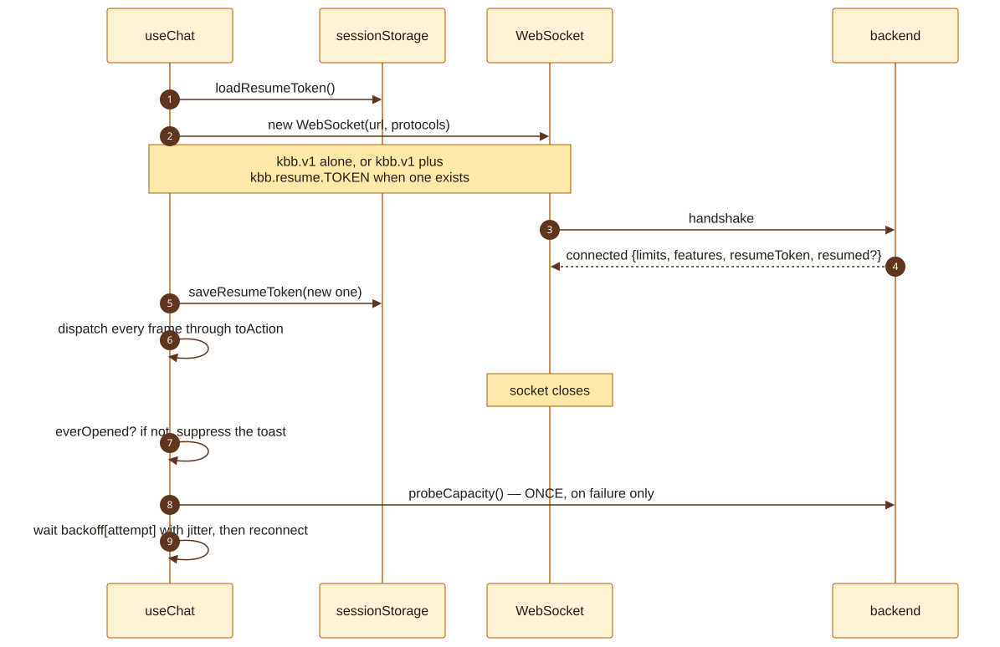

# Frontend architecture

**Read from the code at commit `5ce7166`, 6 September 2026.**

`ARCHITECTURE.md` documents the server and treats the browser as a client. This
document is the other half. It covers what the browser actually owns, what it
deliberately does not, and the handful of failure modes that are specific to
shipping a compiled bundle rather than a running process.

**Diagrams are committed SVGs**, with the mermaid source kept beside each one in
`diagrams/`. See the note at the top of `ARCHITECTURE.md` for why, and for how to
re-render one after editing its `.mmd`.

---

## Contents

1. [Scope, and the one architectural rule](#1-scope-and-the-one-architectural-rule)
2. [Stack and build](#2-stack-and-build)
3. [Configuration — compiled in, not fetched](#3-configuration--compiled-in-not-fetched)
4. [Routing](#4-routing)
5. [The socket](#5-the-socket)
6. [State — the mirror](#6-state--the-mirror)
7. [Presentation — the pure layer](#7-presentation--the-pure-layer)
8. [Browser storage, and what never leaves it](#8-browser-storage-and-what-never-leaves-it)
9. [Component map](#9-component-map)
10. [Hooks](#10-hooks)
11. [The protocol copy](#11-the-protocol-copy)
12. [Feature flags](#12-feature-flags)
13. [The age gate](#13-the-age-gate)
14. [Sign-in from the client side](#14-sign-in-from-the-client-side)
15. [Notifications, sound and attention](#15-notifications-sound-and-attention)
16. [Testing](#16-testing)
17. [Traps specific to this frontend](#17-traps-specific-to-this-frontend)
18. [Gaps and risks](#18-gaps-and-risks)

---

## 1. Scope, and the one architectural rule

**The client decides nothing.** It renders what the server tells it, and it
sends what the user did. `state/machine.ts` states this in its own header: the
state is *"a mirror, not a source. It never decides that it is matched."*

That rule is what makes the rest of the frontend small. There is no client-side
matchmaking, no optimistic conversation, no local copy of who your partner is,
and no derived identity. Where an optimistic transition does exist — pressing
Start moves to a searching screen before the server has answered — it is a flag
(`searchPending`) that the authoritative `queue_status` frame overwrites.

Three things the browser genuinely owns, and the server never sees:

| Owned by the browser | Where | Why the server must not have it |
|---|---|---|
| Age-gate acknowledgement | `localStorage` | A durable per-user record of acceptance is the cross-chat correlator §24.3 and D34 forbid |
| Recent — who you met this visit | `sessionStorage` | Same reason. It is a list of strangers, and it dies with the tab |
| Resume token | `sessionStorage` | It is a bearer credential for one conversation and should die with the tab, exactly as a conversation does |

---

## 2. Stack and build

**CONFIRMED** from `frontend/package.json` and `vite.config.ts`.

| | |
|---|---|
| Framework | React 18.3, function components and hooks only |
| Build | Vite 6, `tsc --noEmit && vite build` |
| Styling | Tailwind 3.4 + PostCSS + autoprefixer |
| Icons | `lucide-react` |
| Fonts | `@fontsource/` — Fraunces, Plus Jakarta Sans, JetBrains Mono, **self-hosted** |
| Tests | Vitest |
| Router | **hand-written, ~80 lines** |
| State | `useReducer` over a hand-written machine. No Redux, no Zustand, no query library |
| Output | Static files served by nginx |

**There are five runtime dependencies and no state-management or routing
library.** That is a deliberate position, argued in `router.tsx`: what the app
needs from routing is "read the path, render one of nine things, and change the
path without a reload" — no nested routes, no params, no loaders. A library that
does all of those is several hundred kilobytes and a migration every major
version.

**Fonts are self-hosted via `@fontsource`, not linked from Google.** That is the
same rule that governs the Buy-Me-a-Coffee button: the privacy policy says the
browser makes no third-party requests, and a font CDN is a third-party request
on every page load, made before the visitor has clicked anything.

### The dev server proxies, and the reasons are not convenience

```
/ws            → ws://localhost:8080   (ws: true)
/health        → http://localhost:8080
/ready         → http://localhost:8080
/api/capacity  → http://localhost:8080
/auth          → http://localhost:8080  (followRedirects: false)
```

Each entry exists because falling through to the SPA produces a *plausible wrong
answer* rather than an error:

- **`/api/capacity`** would answer `200` with `index.html`, the JSON parse would
  fail, and the client would read that as "cannot reach the server" — the one
  answer the probe exists to rule out.
- **`/auth/session`** would answer `200` with `index.html`, which reads as
  "permanently signed out" rather than as a missing proxy.
- **`followRedirects: false`** because `/auth/start` 302s to another origin, and
  following it here would defeat the point — the browser has to land on the
  provider itself.
- **`/ws` on the same origin** because the block token is an HttpOnly
  `SameSite=Lax` cookie. A cross-origin dev setup drops it on every connection
  and makes blocking untestable locally.

---

## 3. Configuration — compiled in, not fetched

**Vite inlines `import.meta.env.VITE_*` at build time.** There is no runtime
config fetch, so a configuration change is a rebuild, and the only honest way to
check a value is to grep the **served bundle**.

### A `VITE_` value has to exist in three places or it silently does not exist

1. the env file,
2. the compose service's `build.args`,
3. a Dockerfile **`ARG` *and* `ENV`** — an `ARG` alone is invisible to Vite.

`scripts/verify-config.mjs` asserts all three. This is the frontend half of the
config trap that `ARCHITECTURE.md` records for the backend.

### Numbers refuse bad values rather than clamping them

`config.ts:186-210`. `readNumber` falls back on zero, on negatives and on
unparseable input; `readNumberList` falls back to the **whole** backoff curve
rather than a partially parsed one, because the shape is the point.

The reasoning is specific to build-time config: a `0` from a typo turns the
reconnect backoff into a spin and every timeout into an instant failure, both of
which read as a broken *server* — and it cannot be corrected without another
build.

### What is configurable

| Setting | Default | What it governs |
|---|---|---|
| `VITE_WS_URL` | same origin | Where the socket connects |
| `VITE_TYPING_IDLE_MS` | 3000 | When the typing indicator stops |
| `VITE_RECONNECT_BACKOFF_MS` | a curve | Reconnect attempts, jittered |
| `VITE_MESSAGE_GROUPING_MS` | 60000 | When consecutive messages merge visually |
| `VITE_TOAST_VISIBLE_MS` | 4000 | Toast lifetime |
| `VITE_CAPACITY_PROBE_TIMEOUT_MS` | 3000 | Bound on the capacity probe |
| `VITE_AUTOSEARCH_BACKOFF_MS` | 6000 | Pause before auto-searching again |
| `VITE_CHECKOUT_LOAD_TIMEOUT_MS` | 15000 | Payment provider script load |
| `VITE_TERMS_URL`, `VITE_PRIVACY_URL` | — | **Required in production**; the prod compose refuses to build without them |
| `VITE_CONTACT_EMAIL`, `VITE_SUPPORT_URL` | — | Published contact routes |
| `VITE_ADS_ENABLED`, `VITE_ADS_PROVIDER` | false, `noop` | Ad slots. Off |
| `VITE_DEV_ACCOUNT_CREDENTIAL` | — | **Warns loudly.** A build carrying a testing account |

---

## 4. Routing

Nine static routes, hand-written, in `router.tsx` and `Root.tsx`.



### `/` is the app; everything else is a document

`App` owns the WebSocket, so **mounting it opens a connection.** It is therefore
mounted on exactly one route — the one where somebody might start a
conversation. Reading the Safety page should not cost a socket, and before
`Root.tsx` existed it did, because every page was an overlay on a live app.

**The consequence to know:** navigating from `/` to a document unmounts `App` and
drops the connection; coming back opens a new session. That is acceptable only
because the footer renders on the landing screen and not inside a conversation —
there is no link out of a live chat. **A link must never be added to the chat
surface without thinking about this first.**

### Unknown paths get a page, not the app

nginx serves `index.html` for any path, so `/saftey` used to render the landing
screen — a soft 404, which is worse than a real one: the visitor believes they
arrived, and a crawler indexes the homepage under a dozen wrong URLs.

### Links are real anchors

`RouteLink` renders `<a href>` and intercepts the click; it does **not** render a
`<button>` styled as a link. Three things a button cannot do: a crawler can
follow it, a middle-click or ctrl-click opens a real tab, and hovering shows the
destination. Any modified click is left entirely alone.

---

## 5. The socket

`hooks/useChat.ts` owns the connection, the reducer, and every command.



### The resume token rides as a subprotocol

`new WebSocket(url, [BASE_PROTOCOL])` with no token, or
`[BASE_PROTOCOL, 'kbb.resume.<token>']` with one. It is the only channel a
browser has during a handshake — `WebSocket` takes no custom headers — and
unlike a query string it does not land in an access log. The server never echoes
it back, which is why `kbb.v1` is offered beside it: there has to be something
harmless to agree on.

### Backoff is jittered, and monotonic on purpose

`withJitter` spreads a reconnect across its window rather than firing on the
tick. The comment records why it is not *full* jitter: full jitter can pick a
shorter wait on a later attempt, so the curve stops being monotonic and a client
in trouble can hammer harder than one that just started.

### `error` is not handled; `close` is

`'error'` is always followed by `'close'`, which is where reconnection lives.
Handling both would double every backoff.

### The capacity probe fires on failure only

Never polled. A refused handshake reaches page script as close code 1006 — no
status, no reason — so "at capacity", "the backend is down" and "the wifi went
away" are indistinguishable. `probeCapacity()` asks over HTTP, and the endpoint
answers **200 even when busy** so a failed fetch and a busy answer cannot be
confused.

### "Connection lost" is a lie on a first connection

`socket_closed` carries `everOpened`. Nothing was lost if nothing was ever held,
so a refused handshake suppresses the toast and leaves the landing screen — where
the person is actually looking — to explain itself.

### Commands

`ChatApi` exposes exactly what the protocol allows: `send`, `typing`, `react`,
`skip`, `leave`, `block`, `report`, `saveConnection`, plus `reconnectStarted`
and the reconnect accept/decline pair. Every one is a `sendCommand` into the
socket. **A refusal is never sent** — declining a reconnect request is local
only, because no frame may disclose a refusal.

---

## 6. State — the mirror

`state/machine.ts`, 794 lines, with a 936-line test file beside it.



`Screen` is exactly `'connecting' | 'idle' | 'searching' | 'chatting' | 'ended'
| 'disconnected'`.

**Message status is separate from screen state:** `'sending' | 'sent' |
'withheld' | 'undelivered' | 'failed'`. `undelivered` exists because the server's
ack reports the route it actually took — a partner with no socket is an ordinary
state lasting tens of seconds under §28, and that is the difference between a
"sent" tick and the truth.

**`EndReason`** is `'you_skipped' | 'partner_left' | 'you_blocked' |
'server_shutdown'` — four, because the copy differs and because auto-search must
fire for some and not others.

### Frames are ignored when they name a different match

Several reducers begin `if (action.payload.matchId !== state.matchId) return
state`. A `message`, a `partner_typing` or a `partner_reacted` arriving for a
conversation that has already ended is dropped rather than rendered. This is the
client half of the server's rule that a late event must not reach whoever holds
that session id now.

---

## 7. Presentation — the pure layer

`view/presentation.ts` exists so the mapping from state to what-the-screen-says
is testable without rendering anything. Every function is pure.

| Function | Answers |
|---|---|
| `connectionOf(screen)` | How the socket is doing, as a person would describe it |
| `phaseOf(state)` | Which layout to show — **takes the state, not the screen** |
| `glyphFor(identity)` | The single character an avatar shows |
| `colourFor(identity)` | The avatar colour |
| `composerDisabled(state)` | Whether the composer is live |
| `showPresence(count)` | Whether to show the online count at all |

**`phaseOf` takes the whole state deliberately.** A dropped socket is not by
itself the end of a conversation — under §28 the seat is held for twenty seconds
— so a session that still holds a match is *in a conversation* whatever its
socket is doing.

**`composerDisabled` is stricter than "are we chatting".** It also respects the
server's `features` gate and the partner-away state, because a message sent
while the partner is away is acked and then dropped (D43), and the composer is
the control that prevents that rather than a buffer.

**`showPresence` is the whole of D21.** The counter is hidden below 100 online
and never faked. The wire format sends `approximate: true` as a literal so the
UI cannot present a count as exact. Hiding a true number says nothing false. If the threshold ever changes, change
the constant — do not synthesise a count and do not add a floor.

---

## 8. Browser storage, and what never leaves it

**CONFIRMED.** This table is the privacy position in its concrete form.

| Key | Store | Dies when | Contents |
|---|---|---|---|
| Age acknowledgement | `localStorage` | never, until the copy version changes | a version number |
| Preferences | `localStorage` | never | UI preferences |
| Profile draft | `localStorage` | never | what you typed, so you need not retype it |
| **Recent** | `sessionStorage` | **the tab closes** | who you met this visit |
| **Resume token** | `sessionStorage` | **the tab closes** | a bearer credential, rotated per use |
| Chat-request marker | `sessionStorage` | the tab closes | survives a navigation into `/` |

**Every access is wrapped.** `localStorage` and `sessionStorage` throw outright
in some private modes and when a browser is set to block site data — they do not
merely return null. `agegate.ts` returns "not acknowledged" when touching storage
throws, which **shows the gate** rather than skipping it; `history.ts` degrades
to an empty list; `preferences.ts` degrades to defaults.

**`localStorage` is synchronous, and reading it during render is a needless
main-thread hit**, so `App.tsx` and `usePreferences` read it in a lazy
`useState` initialiser instead.

---

## 9. Component map

Forty-six components. Grouped by what they are for rather than alphabetically.

### The chat surface

| Component | Responsibility |
|---|---|
| `ChatShell` | The conversation. Largest component at 969 lines; also owns the searching and advancing overlays |
| `MessageList` | Rendering, grouping, reactions, system lines |
| `MessageInput` | The composer |
| `IcebreakerBar` | Opening-line suggestions |
| `SystemMessage` | "They left", "you blocked", etc. |
| `ConnectionStatus` | Socket state, from `connectionOf` |
| `ProfileCard` | The stranger's declared profile |
| `Avatar` | Glyph and colour, from the pure helpers |
| `ReconnectBanner` | An earlier partner asking to talk again |
| `Toast` | Transient notices |

### Entry and identity

| Component | Responsibility |
|---|---|
| `LandingScreen` | Before the first conversation |
| `StartChattingLink` | The single call to action |
| `SampleConversation` | What the product looks like, without a socket |
| `AgeGate` | See §13 |
| `AuthModal` | Sign-in. **Still the pre-OIDC magic-link form; needs replacing, not enabling** |
| `AccountMenu`, `GoogleMark` | Signed-in state |
| `ProfileFields` | The declared profile — a claim, never an attribute |

### Panels and sheets

`SettingsSheet`, `SafetySheet`, `ReportDialog`, `FiltersModal`, `HistoryPanel`
(Recent), `FriendsPanel` (saved connections).

### The editorial site

`EditorialShell` owns the sticky header and pinned footer; `SitePage`,
`SiteNav`, `SiteFooter`, `NotFound`, and the seven content pages — About, How It
Works, Rules, FAQ, Safety, Contact, Premium, Support. Copy lives in `content/`,
not in the components: `legal.ts` (1,541 lines), `pages.ts`, `faq.ts`,
`how-it-works.ts`, `contact.ts`.

### Commerce and ads

`SupportCard`, `SupportPage`, `PremiumPage`, `AdSlot` + `ads/provider.ts`.
**Ads are off** (`VITE_ADS_ENABLED=false`, provider `noop`) and payments are off
in both halves.

---

## 10. Hooks

| Hook | What it does, and the reason it exists |
|---|---|
| `useChat` | The socket, the reducer, every command |
| `useSession` | Signed-in state. **Asks the server once, on mount** — no polling, no revalidate-on-focus, because the credential lasts thirty days |
| `useAutoSearch` | Finds the next stranger when the last one left — **for some endings and not others**. Never after a block (D39), and it backs off rather than having the join limiter widened for it (D40) |
| `useBackButton` | Makes the phone's back button leave the conversation instead of the site |
| `useMatchNotification` | Fires the match alert when the user is looking elsewhere. Watches the **transition into** a conversation, not the state of being in one, so re-renders cannot re-fire it |
| `useDuration` | `mm:ss`, purely cosmetic and deliberately local — the server sends no duration |
| `usePreferences` | Preferences, read lazily out of `localStorage` |

---

## 11. The protocol copy

**`frontend/src/protocol/types.ts` is a generated, byte-identical copy of
`backend/src/protocol/types.ts`.** Never hand-edit it. Edit the backend file and
run `node scripts/verify-protocol.mjs --fix`; `npm run verify` fails the build if
the two drift.

**A value added to a closed list is a backend change, not a UI change.** Adding
`flirty` to `INTENTS` and rebuilding only the frontend does not produce a
cosmetic mismatch: the old validator refuses the value, and the refusal fails the
**whole** `join_queue` with `VALIDATION_FAILED` rather than dropping one field.
Closed lists are validated on both sides on purpose, so both sides ship together.

`COUNTRY_NAMES` lives in the protocol file rather than the frontend because the
moderation console renders country names too. Gender's short labels (`F`/`M`/`NB`)
are client-side only — the wire value stays the full word so stored evidence
reads unambiguously.

---

## 12. Feature flags

`frontend/src/features.ts`. **These are compiled in and ship to production.**
Turning one on is a commit, not a deploy-time setting.

| Flag | Value | Note |
|---|---|---|
| `ACCOUNTS_ENABLED` | **true** | Sign-in is live |
| `FILTERS_ENABLED` | false | |
| `PAYMENTS_ENABLED` | false | |
| `FILTERS_AVAILABLE` | derived | `FILTERS_ENABLED && PAYMENTS_ENABLED` — **not settable**, because each half refuses for its own reason and a single flag would let one be forgotten |
| `SIGNIN_PROVIDER` | `'google'` | Decides whether the button names Google |

**Never flip these on a branch that will merge** while a staged policy patch is
unapplied — that is exactly the half-applied state
`scripts/verify-pending-policy.mjs` exists to catch.

**Absent beats present-and-disabled.** A control that renders and does nothing
still takes focus and still announces itself, then refuses. The filter button
used to open a modal whose only content was "Part of Premium"; Premium,
`/support` and the filter control are now hidden rather than disabled.

---

## 13. The age gate

`agegate.ts` + `components/AgeGate.tsx`. **Child safety relies on this gate
plus reporting and moderation**, so its wording carries more weight than any
other string in the product.

- **Versioned, not dated.** `AGE_GATE_VERSION` — re-asking on a schedule is
  theatre; re-asking when the wording changes tracks what was actually agreed to.
- **It must never be described as age assurance**, in copy or in code.
- **It is the one dialog that does not close on Escape or a backdrop click.**
- **A storage failure shows it** rather than skipping it.
- **Nothing about it reaches the server.** A durable per-user record of
  acceptance is the correlator §24.3 and D34 forbid. The honest cost — that a
  local flag demonstrates nothing to anybody else — is an open legal question in
  `docs/policies/age-gate.md` and is deliberately not assumed either way.

---

## 14. Sign-in from the client side

`useSession` + `auth.ts`.

**It runs in a popup, and the popup deliberately does not reload the page.**
That is what keeps a conversation alive across signing in. Two independent ways
of learning it finished: a `postMessage` (fast) and a close watcher (always
fires). **Neither trusts what it is told** — both end in `readSession()`.

**A full-page redirect is refused during a live conversation.** The navigation
kills the socket, and the twenty-second resume grace cannot cover a round trip
through the provider — the chat would be gone and nothing would report it. The
condition is a live conversation, not `reason === null`: those two agree
everywhere except the one path that matters, signing in from the header mid-chat.

**The `?signin=ok` marker is read once and removed from the URL**, because the
popup is not guaranteed and a marker left in the address bar re-fires on reload.

**`AuthModal` still on disk is the pre-OIDC magic-link form** and checks
`ACCOUNTS_ENABLED && PAYMENTS_ENABLED`. It predates the OIDC decision and needs
replacing, not enabling.

---

## 15. Notifications, sound and attention

`notify.ts`, used by `useMatchNotification`.

- `unlockSound()` — browsers require a user gesture before audio.
- `playMatchChime()` — when a match lands while the tab is not looked at.
- `setTitleAlert()` — the document title, cleared when the page is looked at.
- `requestNotificationPermission()` → `'granted' | 'denied' | 'unsupported'`,
  and `showMatchNotification()`.

All of it is best-effort and none of it is required for the product to work.

---

## 16. Testing

Vitest, eight suites, all hermetic — no browser, no server.

| Suite | What it pins |
|---|---|
| `state/machine.test.ts` | 936 lines. The reducer, by far the most tested thing here |
| `view/presentation.test.ts` | The pure mapping, including the presence threshold |
| `content/pages.test.ts` | The copy — that published claims match what is built |
| `auth.test.ts`, `agegate.test.ts`, `history.test.ts` | Storage-backed modules, including the throwing cases |
| `preferences.test.ts`, `match-preference.test.ts` | Preference encoding |

**What is not tested here:** rendering, layout, and anything requiring a browser.
There is no component test, no snapshot test, no Playwright. That is a real gap
(§18) and it is the reason the layout bugs in §17 were all found by looking.

---

## 17. Traps specific to this frontend

Each of these cost real time and none of them failed loudly.

**A class name in the JS bundle is not a rule in the CSS.**
`max-w-[calc(100vw-1.5rem)]` shipped in the markup, appeared in the bundle, and
produced **no CSS at all**: `calc()` requires spaces around the minus, so the
declaration was invalid and dropped. Tailwind's arbitrary values take
underscores — `max-w-[calc(100vw_-_1.5rem)]`. Grepping the bundle "proved" the
fix twice while the panel stayed broken. **Grep the compiled stylesheet.** And
beware shell escaping while doing it: `sm\:w-72` and `[60vh]` both read as
missing through a shell that ate the backslashes, and neither was.

**`overflow-x-hidden` on an ancestor kills `position: sticky` below it.** When
one axis is `hidden` the other computes to `auto`, so the element becomes the
nearest scrollport and a sticky descendant pins to a box that never scrolls. It
cost the editorial header its stickiness for months and nothing errored. The clip
belongs on the element that already scrolls.

**Pinning something changes what it is.** Making the footer sticky turned it from
the end of a column of prose into chrome — and its alignment to the 680px measure
and the menu button's missing breakpoint were both correct before and wrong
after. Nothing failed; it just looked broken.

**A breakpoint written in two places will drift.** The menu panel opened empty on
desktop because its contents were `md:hidden` and its button was not. State the
width once, on the control that opens the thing.

**`max-w` bounds a panel's width and says nothing about its position.** A 288px
popover centred on a control in a narrow row still hangs off screen, and the half
that hangs off is the right-hand one — where the buttons are. Below `sm` the
panels are fixed to the viewport instead of anchored to their button.

**Verify the served artifact, not the source.** "Tests pass" and "I checked it in
a browser" are different claims, and the second is worthless unless it names
*which* build. This cost three separate rounds — a container six commits behind,
a Vite dev server on `:5173` checked and reported as verification of a container
on `:8081`, and a container rebuilt before the last two commits landed.
`docker exec <c> grep -rlo "<a string only the new build has>"
/usr/share/nginx/html/assets/*.js` settles it in seconds.

**Verify which artifact the *reporter* is looking at, too.** A report of removed
copy still appearing was diagnosed while a dev server and the container were both
serving this repo. Both were current; the answer was a cached page.

**The mark is drawn in three places and they must agree**: `Logo.tsx`,
`public/favicon.svg` (inset so strokes clear the plate corners) and
`docs/brand/*.svg`. The two arcs differ in **size** as well as opacity, and the
size is the half that survives greyscale.

---

## 18. Gaps and risks

| Gap | Assessment |
|---|---|
| **No component, snapshot or browser test** | The largest gap. Every layout bug in §17 was found by looking at it, and the suite cannot see layout at all. A handful of Playwright checks over the landing screen, a live conversation and the editorial header would have caught most of them |
| **`AuthModal` is pre-OIDC and still on disk** | It checks the wrong flags and implements a flow that no longer exists. Dead code that looks live |
| **`ChatShell` is 969 lines** | It owns the conversation, the searching overlay, the advancing overlay, a countdown and profile formatting. Not urgent, but it is where the next layout bug will be |
| **No error boundary** | A render throw anywhere blanks the page. There is no `componentDidCatch` in the tree |
| **No client-side telemetry** | Deliberate — the privacy policy says the browser makes no third-party requests — but it means the funnel is blind before the socket opens, and the age gate cannot be measured at all |
| **Bundle size is unmeasured** | No budget, no CI check. The dependency list is short enough that this has not bitten, which is not the same as being safe |
| **`react` and `react-dom` are not pinned in the image** | `^18.3.1`. Fine until it is not |

---

*Companion to `ARCHITECTURE.md`, which covers the server, the protocol contract
and the deployment. Where the two describe the same thing, the server document
is authoritative on the wire and this one on the browser.*
